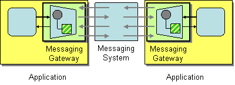

import EipSetUp from '../../../_partials/eip-set-up.mdx';

# Messaging Gateway

This page explains how you can implement a sample scenario of the Messaging Gateway EIP using WSO2 Integrator: MI.

## Introduction to Messaging Gateway

The Messaging Gateway EIP encapsulates message-specific code from the rest of the application. It is a class that wraps messaging-specific method calls and exposes domain-specific methods to the application. Only the Messaging Gateway knows about the actual implementation of the messaging system. The rest of the application calls the methods of the Messaging Gateway, which are exposed to external applications. 

:::info

For more information, see the [Messaging Gateway](http://www.eaipatterns.com/MessagingGateway.html) documentation.

:::



## Sample scenario

This sample scenario demonstrates creating a proxy service with a publishWSDL element. The published WSDL's methods act as the Message Gateway, hiding details of the actual backend service, and exposing only domain-specific methods to the client application.

Proxy services in WSO2 MI act as Messaging Gateways, abstracting the details of the actual backend services from implementing clients. For a more complex example of how WSO2 MI can act as a Messaging Gateway, refer to the [Health Care Scenario](../../integration-tutorials/exposing-several-services-as-a-single-service.mdx), where a REST API acts as a Messaging Gateway between several backend services.

The diagram below depicts how to simulate the sample scenario using WSO2 MI.


Before digging into implementation details, let's take a look at the relationship between the sample scenario and the Messaging Gateway EIP by comparing their core components.

| Messaging Gateway EIP            | Messaging Gateway Example Scenario            |
|----------------------------------|-----------------------------------------------|
| Application                      | Simple Stock Quote Client / Service           |
| Messaging Gateway                | Proxy Service                                 |

## Synapse configuration of the artifacts

Given below is the synapse configuration of this sample.

<Tabs>
<TabItem value="tab-0" label="Proxy Service">

```xml
<?xml version="1.0" encoding="UTF-8"?>
<proxy name="StockQuoteProxy" startOnLoad="true" transports="http https" xmlns="http://ws.apache.org/ns/synapse">
    <target>
        <inSequence>
        <call>
            <endpoint key="SimpleStockEp"/>
        </call>
        <respond/>
        </inSequence>
        <faultSequence>
        <log category="INFO" level="full">
            <property name="MESSAGE" value="Executing default &amp;#34;fault&amp;#34; sequence"/>
            <property name="ERROR_CODE" expression="get-property('ERROR_CODE')"/>
            <property name="ERROR_MESSAGE" expression="get-property('ERROR_MESSAGE')"/>
        </log>
        <drop/>
        </faultSequence>
    </target>
    <publishWSDL key="gov:sample_proxy_3.wsdl" preservePolicy="true">
    </publishWSDL>
</proxy>
```

</TabItem>
<TabItem value="tab-1" label="Endpoint">

```xml
<?xml version="1.0" encoding="UTF-8"?>
<endpoint name="SimpleStockEp" xmlns="http://ws.apache.org/ns/synapse">
    <address uri="http://localhost:9000/services/SimpleStockQuoteService">
        <suspendOnFailure>
            <initialDuration>-1</initialDuration>
            <progressionFactor>1</progressionFactor>
        </suspendOnFailure>
        <markForSuspension>
            <retriesBeforeSuspension>0</retriesBeforeSuspension>
        </markForSuspension>
    </address>
</endpoint>
```

</TabItem>
</Tabs>

Download the [sample_proxy_3.wsdl](../../../../assets/attachments/wsdl/sample_proxy_3.wsdl) file and add it as a Registry Resource. For instructions on how to create a Registry Resource, refer to the [Create a Registry Resource](../../../develop/creating-artifacts/creating-registry-resources.mdx) documentation.

Let's investigate the elements of the ESB configuration in detail. 

- **proxy** - Defines a new proxy service called `StockQuoteProxy`.
- **endpoint** - Defines the endpoint of the actual backend service that this proxy service is connected to.
- **publishWSDL** - Defines the WSDL file to expose for this proxy service. If no `publishWSDL` is given, the actual backend service's WSDL is exposed. 

## Set up the sample scenario

Follow the below instructions to simulate this sample scenario.

<EipSetUp />

3. Download the [backend service](https://github.com/wso2-docs/WSO2_EI/blob/master/Back-End-Service/axis2Server.zip).

4. Extract the downloaded zip file.

5. Open a terminal, and navigate to the `axis2Server/bin/` directory inside the extracted folder.

6. Execute the following command to start the axis2server with the SimpleStockQuote backend service:

    <Tabs>
    <TabItem value="tab-0" label="On MacOS/Linux">

      ```bash
      sh axis2server.sh
      ```

    </TabItem>
    <TabItem value="tab-1" label="On Windows">

      ```bash
      axis2server.bat
      ``` 

    </TabItem>
    </Tabs>

7. Download the artifacts of the sample.

    <a href="/integration/micro-integrator/assets/attachments/learn/enterprise-integration-patterns/MessagingGateway.zip">
        
    </a>

8. Import the artifacts to WSO2 MI.

    Click **File** -> **Open Folder** -> Select the extracted ZIP file to import the downloaded ZIP file.

9. Start the project in the WSO2 MI server.

    For instructions, go to [Build and Run](../../../develop/deploy-artifacts.mdx#build-and-run) Documentation.

## Execute the sample

If you navigate to `http://localhost:9000/services/SimpleStockQuoteService?wsdl`, you can see the WSDL file of the backend server. There are five methods exposed externally, but the Proxy Service `StockQuoteProxy` exposes only four externally, filtering out the `getFullQuote` method. See the `StockQuoteProxy` WSDL file in `http://localhost:8290/services/StockQuoteProxy?wsdl`.

Send the following request to the above proxy service.

```
POST /services/StockQuoteProxy HTTP/1.1
Host: localhost:8290
soapAction: urn:getFullQuote
Content-Type: text/xml

<soapenv:Envelope xmlns:soapenv="http://schemas.xmlsoap.org/soap/envelope/" xmlns:ser="http://services.samples" xmlns:xsd="http://services.samples/xsd">
   <soapenv:Header/>
   <soapenv:Body>
      <ser:getFullQuote>
         <ser:request>
            <xsd:symbol>WSO2</xsd:symbol>
         </ser:request>
      </ser:getFullQuote>
   </soapenv:Body>
</soapenv:Envelope>
```

## Analyze the output

After sending the above message to the MI server, you'll receive an internal server error as below. 

```xml
<?xml version='1.0' encoding='UTF-8'?>
<soapenv:Envelope xmlns:soapenv="http://schemas.xmlsoap.org/soap/envelope/">
    <soapenv:Body>
        <soapenv:Fault xmlns:axis2ns4="http://schemas.xmlsoap.org/soap/envelope/">
            <faultcode>axis2ns4:Client</faultcode>
            <faultstring>The endpoint reference (EPR) for the Operation not found is /services/StockQuoteProxy and the WSA Action = urn:getFullQuote. If this EPR was previously reachable, please contact the server administrator.</faultstring>
            <detail/>
        </soapenv:Fault>
    </soapenv:Body>
</soapenv:Envelope>
```

The reason for this error is that the `getFullQuote` method is not exposed through `StockQuoteProxy`, even though the backend server supports it.

Specifying a different published WSDL file that contains the `getFullQuote` method and sending the same SOAP message to the server will allow you to get the correct response from the server.
