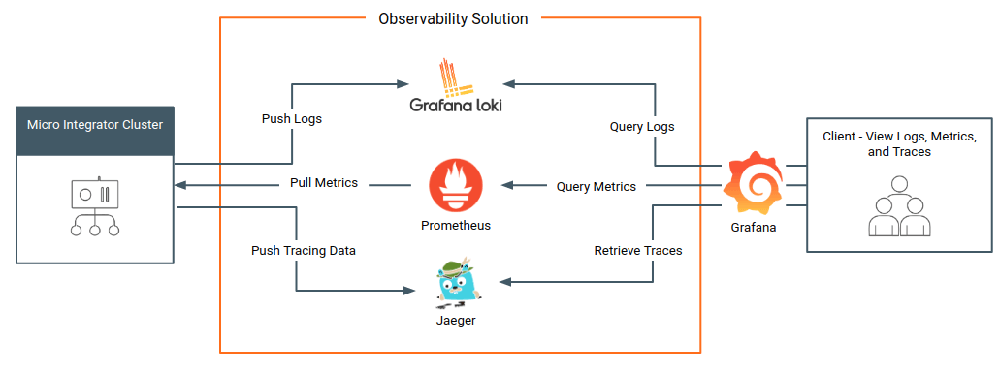
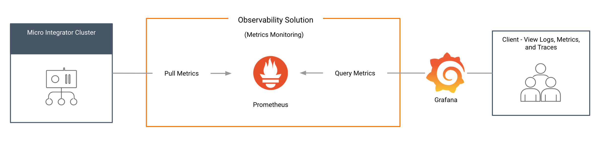
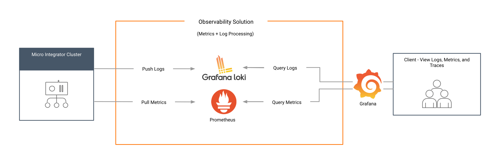
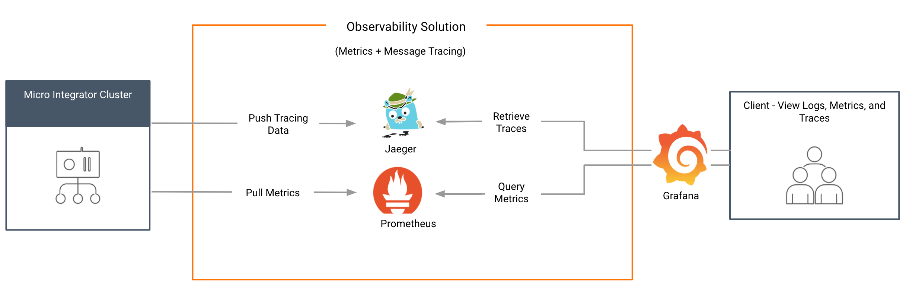

#WSO2 Integrator: MI Observability Overview

The following diagram depicts the complete **Grafana** based observability solution for your WSO2 Integrator: MI deployment, which includes **metrics monitoring**, **log monitoring**, and **message tracing** capabilities.

## Minimum Grafana based observability

The basic deployment offers you metrics capabilities. You can set up the basic deployment with only Prometheus and Grafana to view and explore with the available Prometheus metrics.

## Grafana based observability add ons

You can also set up different flavors of the observability solution depending on your requirement.

### Log processing add on
 
Once you set up the basic deployment, you can integrate log-processing capabilities. To use this, you need to install **Fluent-Bit** as the logging agent and **Grafana Loki** as the log aggregator.

### Message tracing add on

Once you set up the basic deployment, you can integrate message tracing capabilities. To use this you need to install **Jaeger**.  

## Observability solutions

There are two Grafana based observability solutions for the WSO2 Integrator: MI; The Kubernetes based deployment and the VM based deployment.

These solutions are suitable for the following combination of operations.

<table><tbody><tr><th><b>{"Observability solution"}</b></th><th><b>{"Operations"}</b></th><th><b>{"Description"}</b></th></tr><tr><td>{"Grafana based observability for a WSO2 Integrator: MI Deployment in Kubernetes"}</td><td><ul><li>{"Metrics only"}</li><li>{"Metrics + Logging"}</li><li>{"Metrics + Tracing"}</li><li>{"Metrics + Logging + Tracing"}</li></ul></td><td><ul><li>{"The default Grafana based Kubernetes solution comes with metrics enabled."}</li><li>{"You can also configure logging and tracing in combination with this."}</li><li>{"This solution is ideal in the following situations. "}<ul><li>{"If you want a complete Grafana based solution for observability."}</li><li>{"If you already have Prometheus, Grafana, and Jaeger as your in-house monitoring and observability tools."}</li></ul></li><li>{"For more information, see the "}<a href={"/integration/micro-integrator/observe-and-manage/setting-up-cloud-native-observability-in-kubernetes"}>{"Kubernetes Deployment Getting Started Guide"}</a>{"."}</li></ul></td></tr><tr><td>{"Grafana based VM deployment"}</td><td><ul><li>{"Metrics only"}</li><li>{"Logging (add-on)"}</li><li>{"Tracing (add-on)"}</li></ul></td><td><ul><li>{"The default Grafana based VM solution comes with metrics enabled."}</li><li>{"You can additionally set up logging or tracing separately as part of this solution later."}</li><li>{"This solution is ideal if you want a complete Grafana based solution for observability, but you need to set this up on a VM. Ideally, you would already have Prometheus, Grafana, and Jaeger as your in-house monitoring and observability tools."}</li><li>{"For more information, see the "}<a href={"/integration/micro-integrator/observe-and-manage/setting-up-cloud-native-observability-on-a-vm"}>{"VM Deployment Getting Started Guide"}</a>{"."}</li></ul></td></tr></tbody></table>

## Technologies

The Grafana based observability solution is based on proven projects from the **Cloud Native Computing Foundation**, which makes the solution cloud native and future proof. Following are the technologies used in the current solution:

| **Feature**   | **Technology**              |
|---------------|-----------------------------|
| Metrics       | Prometheus                  |
| Visualization | Grafana                     |
| Logging       | Log4j2, Fluent-Bit, and Grafana Loki |
| Tracing       | Jaeger                      |

## What's next?

-	Set up <a href="/integration/micro-integrator/observe-and-manage/setting-up-cloud-native-observability-on-a-vm">Grafana based observability on a VM</a>.
-	Set up <a href="/integration/micro-integrator/observe-and-manage/setting-up-cloud-native-observability-in-kubernetes/">Grafana based observability on Kubernetes</a>.
