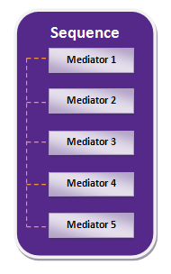
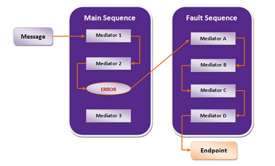

# Mediation Sequences

A mediation sequence is a set of [mediators](mediators/about-mediators.mdx) organized into a logical flow, allowing you to implement pipes and filter patterns. The mediators in the sequence will perform the necessary message processing and route the message to the required destination.

Typically, the required mediation sequences are defined within the proxy service or the REST API. This includes an [In](#inout-sequences) sequence, an [Out](#inout-sequences) sequence, and a [default fault](#fault-sequences) sequence.

All messages that are not destined for a proxy service or REST API are sent through the [main sequence](#main-sequence). Some other sequences ([named sequences](#named-sequences)) are defined independent of the proxy service, or REST API, and then reused in one or several proxy services, REST APIs for efficiency.

## IN/OUT Sequences

Once a request message is received by the [proxy service](synapse-properties/proxy-service-properties.mdx), [REST API](synapse-properties/rest-api-properties.mdx), [inbound endpoint](synapse-properties/inbound-endpoints/about-inbound-endpoints.mdx), or even the [main sequence](#main-sequence), the message is injected to the **IN** sequence. The **OUT** sequence defines the mediation logic that processes the response message before sending the response back to the client.

## Fault Sequences

Fault sequences are used for [error handling](synapse-properties/endpoint-properties.mdx#endpoint-error-handling-properties) in message mediation. A fault sequence is a collection of [mediators](#mediators) just like any other [sequence](#mediation-sequences), and it can be associated with another [sequence](#mediation-sequences), [proxy service](synapse-properties/proxy-service-properties.mdx), or [REST API](synapse-properties/rest-api-properties.mdx). When an error occurs in the mediation logic, the message that triggered the error is delegated to the specified fault sequence. The mediators in the fault sequence can then log the erroneous message, forward it to a special error-tracking service, and send a SOAP fault back to the client indicating the error or even send an email to the system admin.

If a fault sequence is not specified explicitly, the **default** fault sequence of the proxy service or REST API will be used to handle errors. The default fault sequence will log the message, the payload, and any error/exception encountered before the [Drop](mediators/drop-mediator.mdx) mediator stops further processing. You should configure the fault sequence for error handling instead of simply dropping messages.

## Named Sequences

A named sequence is a custom, reusable sequence that holds a specific mediation logic. You can create named sequences and reuse them within your project. A [fault sequence](#fault-sequences) is an example of a named sequence that can be used to replace the default fault sequence of a proxy service, or REST API. While the [main sequence](#main-sequence), [proxy service](synapse-properties/proxy-service-properties.mdx), and [REST API](synapse-properties/rest-api-properties.mdx) contain [IN and OUT](#inout-sequences) sequences to define a specific in flow and out flow of messages, a named sequence is simply a combination of mediators that can be reused within an [IN](#inout-sequences) sequence or [Out](#inout-sequences) sequence.

To reuse a named sequence in multiple integration projects, you need to save it as a [dynamic sequence](#dynamic-sequences).

## Dynamic Sequences

When you create a [named sequence](#named-sequences), you can save it as a **registry resource** in the product's [registry](../get-started/key-concepts.mdx#registry). This sequence can then be dynamically reused in the mediation flow of any of your integration projects by specifying the registry path.

## Main Sequence

All messages that are not destined for a [proxy service](synapse-properties/proxy-service-properties.mdx), [REST API](synapse-properties/rest-api-properties.mdx), or [inbound endpoint](synapse-properties/inbound-endpoints/about-inbound-endpoints.mdx) are sent through the main sequence. A sequence functions as the main sequence when it is named '<b>main</b>'. By default, the main sequence simply sends a message without mediation. Therefore, to add message mediation, you can add mediators and/or [named sequences](#named-sequences) to the main sequence.
