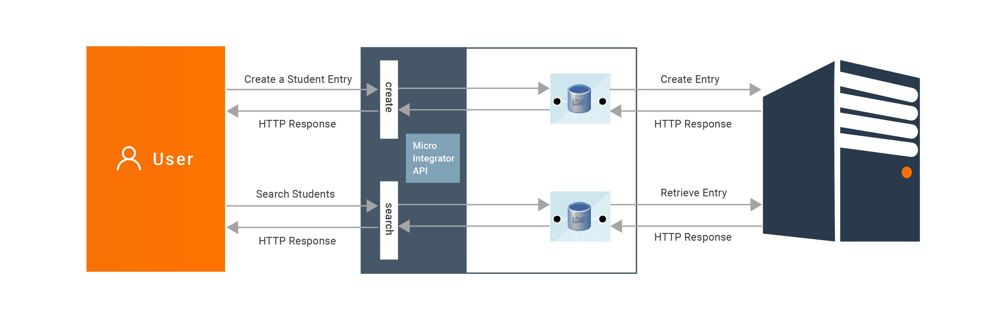
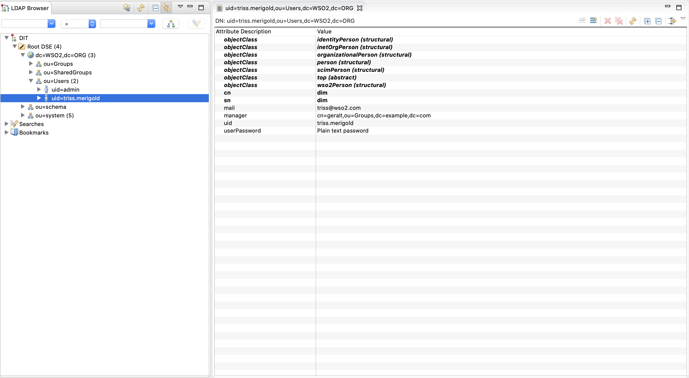

# LDAP Connector Example

Given below is a sample scenario that demonstrates how to perform CRUD operations on LDAP entries using LDAP Connector.

## What you'll build

This example demonstrates on how to use the LDAP connector to create and read LDAP entries on a student directory. 
    

This will have 2 API resources, `create`, `search`.

todo : add an image

* `/create` : This will create a new LDAP entry in the LDAP server.

* `/search` : This will performs a search for one or more LDAP entities with the specified search keys.

If you do not want to configure this yourself, you can simply [get the project](#get-the-project) and run it.

## Configure the connector in WSO2 Integration Studio

Before you begin, see [Setting up LDAP](setting-up-ldap.mdx) if you need to setup an LDAP and try this out. 

Follow these steps to set up the Integration Project and the Connector Exporter Project. 

1. Open WSO2 Integration Studio and select **New Integration Project** to create an Integration Project.
   <a href="https://apim.docs.wso2.com/en/4.1.0/assets/img/integrate/new-project/new-integration-project.png"></a>

2. Right-click on the ESB Config project of the project that you created and click on **Add or Remove Connector** -> **Add Connector**. You will get directed to the WSO2 Connector Store.

3. Search for the specific connector required for your integration scenario and download it to the workspace.
   <a href="https://apim.docs.wso2.com/en/4.1.0/assets/img/integrate/connectors/search-connector.png"></a>

4. Click **Finish**, and your Integration Project is ready. The downloaded connector is displayed on the side palette with its operations. 

5. You can drag and drop the operations to the design canvas and build your integration logic.
   <a href="https://apim.docs.wso2.com/en/4.1.0/assets/img/integrate/connectors/drag-connector-operation.png"></a>
  
6. Right click on the created Integration Project and select **New** -> **Rest API** to create the REST API. 
 

1. Right click on the created Integration Project and select, **New** -> **Rest API** to create the REST API. 
   
2. Provide the API name as `college_student_api` and the API context as `/student`. You can go to the source view of the 
xml configuration file of the API and copy the following configuration. 
    ```xml
    <?xml version="1.0" encoding="UTF-8"?>
    <api context="/student" name="college_student_api" xmlns="http://ws.apache.org/ns/synapse">
        <resource methods="POST" url-mapping="/create">
            <inSequence>
                <sequence key="init_sequence"/>
                <sequence key="add_student_sequence"/>
            </inSequence>
            <outSequence/>
            <faultSequence/>
        </resource>
        <resource methods="POST" url-mapping="/search">
            <inSequence>
                <sequence key="init_sequence"/>
                <sequence key="search_student_sequence"/>
            </inSequence>
            <outSequence/>
            <faultSequence/>
        </resource>
    </api>
    ```
   
3. Right click on the created Integration Project and select, -> **New** -> **Sequence** to create the following 
sequences.

    * init_sequence - `<ldap.init>` element authenticates with the LDAP server in order to gain access to perform various 
    LDAP operations.
        ```xml
        <?xml version="1.0" encoding="UTF-8"?>
        <sequence name="init_sequence" trace="disable" xmlns="http://ws.apache.org/ns/synapse">
            <property expression="json-eval($.secureConnection)" name="secureConnection" scope="default" type="STRING"/>
            <property expression="json-eval($.disableSSLCertificateChecking)" name="disableSSLCertificateChecking" scope="default" type="STRING"/>
            <property expression="json-eval($.providerUrl)" name="providerUrl" scope="default" type="STRING"/>
            <property expression="json-eval($.securityPrincipal)" name="securityPrincipal" scope="default" type="STRING"/>
            <property expression="json-eval($.securityCredentials)" name="securityCredentials" scope="default" type="STRING"/>
            <ldap.init>
                <providerUrl>{$ctx:providerUrl}</providerUrl>
                <securityPrincipal>{$ctx:securityPrincipal}</securityPrincipal>
                <securityCredentials>{$ctx:securityCredentials}</securityCredentials>
                <secureConnection>{$ctx:secureConnection}</secureConnection>
                <disableSSLCertificateChecking>{$ctx:disableSSLCertificateChecking}</disableSSLCertificateChecking>
            </ldap.init>
        </sequence>
        ```

    * add_student_sequence - `<ldap.addEntry>` element creates a new LDAP entry in the LDAP server
        ```xml
        <?xml version="1.0" encoding="UTF-8"?>
        <sequence name="add_student_sequence" trace="disable" xmlns="http://ws.apache.org/ns/synapse">
            <property expression="json-eval($.content.objectClass)" name="objectClass" scope="default" type="STRING"/>
            <property expression="json-eval($.content.attributes)" name="attributes" scope="default" type="STRING"/>
            <property expression="json-eval($.content.dn)" name="dn" scope="default" type="STRING"/>
            <ldap.addEntry>
                <objectClass>{$ctx:objectClass}</objectClass>
                <attributes>{$ctx:attributes}</attributes>
                <dn>{$ctx:dn}</dn>
            </ldap.addEntry>
            <respond/>
        </sequence>
        ```
      
    * search_student_sequence - `<ldap.searchEntry>` element search for one or more LDAP entities based on the specified 
    search keys.
        ```xml
        <?xml version="1.0" encoding="UTF-8"?>
        <sequence name="search_student_sequence" trace="disable" xmlns="http://ws.apache.org/ns/synapse">
            <property expression="json-eval($.content.objectClass)" name="objectClass" scope="default" type="STRING"/>
            <property expression="json-eval($.content.filters)" name="filters" scope="default" type="STRING"/>
            <property expression="json-eval($.content.attributes)" name="attributes" scope="default" type="STRING"/>
            <property expression="json-eval($.content.dn)" name="dn" scope="default" type="STRING"/>
            <ldap.searchEntry>
                <objectClass>{$ctx:objectClass}</objectClass>
                <limit>1000</limit>
                <filters>{$ctx:filters}</filters>
                <dn>{$ctx:dn}</dn>
                <attributes>{$ctx:attributes}</attributes>
            </ldap.searchEntry>
            <respond/>
        </sequence>
        ```

## Exporting Integration Logic as a CApp

**CApp (Carbon Application)** is the deployable artifact on the integration runtime. Let us see how we can export integration logic we developed into a CApp along with the connector. 

### Creating Connector Exporter Project

To bundle a Connector into a CApp, a `Connector Exporter Project` is required. 

1. Navigate to **File** -> **New** -> **Other** -> **WSO2** -> **Extensions** -> **Project Types** -> **Connector Exporter Project**.
   
    <a href="https://apim.docs.wso2.com/en/4.1.0/assets/img/integrate/connectors/connector-exporter-project-1.jpg"></a>

2. Enter a name for the Connector Exporter Project. 

3. In the next screen select, **Specify the parent from workspace** and select the specific Integration Project you created from the dropdown.
    <a href="https://apim.docs.wso2.com/en/4.1.0/assets/img/integrate/connectors/connector-exporter-project-naming.png"></a>

4. Now you need to add the Connector to Connector Exporter Project that you just created. Right-click the Connector Exporter Project and select, **New** -> **Add Remove Connectors** -> **Add Connector** -> **Add from Workspace** -> **Connector**.

5. Once you are directed to the workspace, it displays all the connectors that exist in the workspace. You can select the relevant connector and click **Ok**.

    <a href="https://apim.docs.wso2.com/en/4.1.0/assets/img/integrate/connectors/adding-connector-to-exporter-project-3.jpg"></a>

### Creating a Composite Application Project

To export the `Integration Project` as a CApp, a `Composite Application Project` needs to be created. Usually, when an Integration project is created, this project can be created as part of that project by Integration Studio. If not, you can specifically create it by navigating to  **File** -> **New** -> **Other** -> **WSO2** -> **Distribution** -> **Composite Application Project**. 

### Exporting the Composite Application Project

1. Right-click the Composite Application Project and click **Export Composite Application Project**.
   
    

2. Select an **Export Destination** where you want to save the .car file. 

3. In the next **Create a deployable CAR file** screen, select both the created Integration Project and the Connector Exporter Project to save and click **Finish**. The CApp is created at the specified location provided at the previous step.
   
    <a href="https://apim.docs.wso2.com/en/4.1.0/assets/img/integrate/connectors/saving-projects.png"></a>


## Get the project

You can download the ZIP file and extract the contents to get the project code.

<a href="/integration/micro-integrator/_versions/4.2.0/assets/attachments/connectors/ldap_connector_project.zip">
    
</a>

## Deployment

Follow these steps to deploy the exported CApp in the integration runtime. 

**Deploying on Micro Integrator**

You can copy the composite application to the `<PRODUCT-HOME>/repository/deployment/server/carbonapps` folder and start the server. Micro Integrator will be started and the composite application will be deployed.

You can further refer the application deployed through the CLI tool. See the instructions on [managing integrations from the CLI](../../../observe-and-manage/managing-integrations-with-apictl.mdx).

<details>
<summary>Click here for instructions on deploying on WSO2 Enterprise Integrator 6</summary>

1. You can copy the composite application to the `<PRODUCT-HOME>/repository/deployment/server/carbonapps` folder and start the server.

2. WSO2 EI server starts and you can login to the Management Console https://localhost:9443/carbon/ URL. Provide login credentials. The default credentials will be admin/admin. 

3. You can see that the API is deployed under the API section. 

</details>

## Testing

### Create an entry in ldap server

1. Create a file named student_data.json with following sample payload.
    ```json
        { 
          "providerUrl":"ldap://localhost:10389/",
          "securityPrincipal":"uid=admin,ou=system",
          "securityCredentials":"admin",
          "secureConnection":"false",
          "disableSSLCertificateChecking":"false",
          "content":{ 
             "objectClass":"identityPerson",
             "dn":"uid=triss.merigold,ou=Users,dc=wso2,dc=org",
             "attributes":{ 
                "mail":"triss@wso2.com",
                "userPassword":"geralt&triss",
                "sn":"dim",
                "cn":"dim",
                "manager":"cn=geralt,ou=Groups,dc=example,dc=com"
             }
          }
        }
    ```

2. Invoke the API as shown below using the curl command. Curl Application can be downloaded from [here](https://curl.haxx.se/download.html).
    ```
    curl -H "Content-Type: application/json" -X POST --data @student_data.json http://localhost:8290/student/create
    ```

**Expected Response**: 
1. You should get a 'Success' response. 
2. Open Apache Directory Studio and category DIT (Directory Information Tree) shows the hierarchical content of the 
directory. Expand, collapse the tree and you will see the new entries. Select the entry and you will see it's attributes 
and values on Entry Editor.
    

### Search ldap entries

1. Create a file named search_student.json with following sample payload
    ```json
        {
            "providerUrl": "ldap://localhost:10389/",
            "securityPrincipal": "uid=admin,ou=system",
            "securityCredentials": "admin",
            "secureConnection": "false",
            "disableSSLCertificateChecking": "false",
            "application": "ldap",
            "operation": "searchEntity",
            "content": {
                "objectClass": "identityPerson",
                "filters": {
                    "manager": "cn=geralt,ou=Groups,dc=example,dc=com"
                },
                "dn": "ou=Users,dc=wso2,dc=org",
                "attributes": "mail,uid"
            }
        }
    ```

2. Invoke the API as shown below using the curl command. 
    ```
    curl -H "Content-Type: application/json" -X POST --data @search_student.json http://localhost:8290/student/search
    ```

**Expected Response**: 
You should get all entries that match with the provided filter. A sample response is as follows.
```json
    {
        "result": {
            "entry": [
                {
                    "dn": "uid=triss.merigold,ou=Users,dc=WSO2,dc=ORG",
                    "mail": "triss@wso2.com",
                    "uid": "triss.merigold"
                },
                {
                    "dn": "uid=yennefer.of.vengerberg,ou=Users,dc=WSO2,dc=ORG",
                    "mail": "yenna@wso2.com",
                    "uid": "yennefer.of.vengerberg"
                }
            ]
        }
    }
```
## What's Next

* To customize this example for your own scenario, see [LDAP Connector Configuration](ldap-server-configuration.mdx) documentation for all operation details of the connector.
