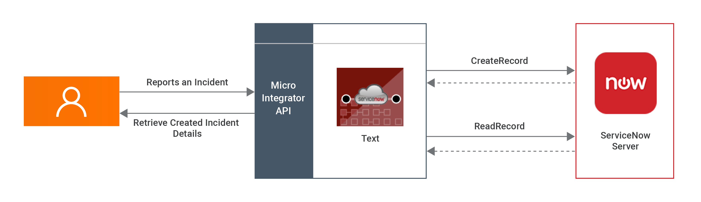

# ServiceNow Connector Example

The WSO2 ServiceNow connector allows you to access the ServiceNow REST API from an integration sequence. Using ServiceNow connector you can work with Aggregate API, Import Set API and Table API in ServiceNow. You can further read about ServiceNow REST APIs from [here](https://developer.servicenow.com/dev.do#!/reference/api/orlando/rest/c_TableAPI).

## What you'll build

This example explains how to use ServiceNow Connector to create records in a table and retrieve its information. Assume your organization uses ServiceNow support and you need to create an incident. In order to do that we can use the tableAPI, which is a REST API. This can be easily done using WSO2 ServiceNow connector. Whenever you need to raise an incident at ServiceNow, the above API can be called with the required information.

It will have two HTTP API resources, which are `postRecord` and `readRecord`. 

[](../../../../../assets/img/integrate/connectors/servicenow-scenario.png)

* `/postRecord`: It creates a new record in the existing incident table in the ServiceNow instance.

* `/readRecord `: It reads the detailed information about the created incident record in the incident table.

If you do not want to configure this yourself, you can simply [get the project](#get-the-project) and run it.

## Setting up the environment 

Please follow the steps mentioned in the [Setting up ServiceNow Instance](settingup-servicenow-instance.mdx) document in order to create a ServiceNow Instance and obtain the credentials. Keep them saved to be used in the next steps.  

## Configure the connector in WSO2 Integration Studio

Follow these steps to set up the Integration Project and the Connector Exporter Project. 

1. Open WSO2 Integration Studio and select **New Integration Project** to create an Integration Project.
   <a href="https://apim.docs.wso2.com/en/4.1.0/assets/img/integrate/new-project/new-integration-project.png"></a>

2. Right-click on the ESB Config project of the project that you created and click on **Add or Remove Connector** -> **Add Connector**. You will get directed to the WSO2 Connector Store.

3. Search for the specific connector required for your integration scenario and download it to the workspace.
   <a href="https://apim.docs.wso2.com/en/4.1.0/assets/img/integrate/connectors/search-connector.png"></a>

4. Click **Finish**, and your Integration Project is ready. The downloaded connector is displayed on the side palette with its operations. 

5. You can drag and drop the operations to the design canvas and build your integration logic.
   <a href="https://apim.docs.wso2.com/en/4.1.0/assets/img/integrate/connectors/drag-connector-operation.png"></a>
  
6. Right click on the created Integration Project and select **New** -> **Rest API** to create the REST API. 
 

1. First let's create postRecord sequence and ReadRecord sequences. Right click on the created Integration Project and select, -> **New** -> **Sequence** to create the Sequence. 

    <a href="/integration/micro-integrator/assets/img/integrate/connectors/add-sequence.jpg"></a>

2. Provide the Sequence name as PostRecord. You can go to the source view of the XML configuration file of the API and copy the following configuration. 
    ```xml
      <?xml version="1.0" encoding="UTF-8"?>
      <sequence name="PostRecord" trace="disable" xmlns="http://ws.apache.org/ns/synapse">
      <servicenow.init>
          <serviceNowInstanceURL>https://dev55707.service-now.com</serviceNowInstanceURL>
          <username>admin</username>
          <password>Diazo123@</password>
      </servicenow.init>
      <servicenow.postRecord>
          <tableName>incident</tableName>
          <sysparmDisplayValue>true</sysparmDisplayValue>
          <sysparmFields>short_description,number,sys_id</sysparmFields>
          <sysparmView>short_description,number,sys_id</sysparmView>
          <sysparmInputDisplayValue>true</sysparmInputDisplayValue>
          <number>34</number>
          <shortDescription>{$ctx:shortDescription}</shortDescription>
          <active>true</active>
          <approval>owner</approval>
          <category>inquiry</category>
          <contactType>{$ctx:contactType}</contactType>
      </servicenow.postRecord>
      <property expression="json-eval($.result.sys_id)" name="sysId" scope="default" type="STRING"/>
      </sequence>
    ```
3. Create the ReadRecord sequence as below. 
    ```xml
    <?xml version="1.0" encoding="UTF-8"?>
    <sequence name="ReadRecord" trace="disable" xmlns="http://ws.apache.org/ns/synapse">
        <servicenow.init>
            <serviceNowInstanceURL>https://dev55707.service-now.com</serviceNowInstanceURL>
            <username>admin</username>
            <password>Diazo123@</password>
        </servicenow.init>
        <servicenow.getRecordById>
            <sysId>{$ctx:sysId}</sysId>
            <tableName>incident</tableName>
        </servicenow.getRecordById>
    </sequence>
    ```
4. Now right click on the created Integration Project and select **New** -> **Rest API** to create the REST API. 
  
5. Provide the API name as ServiceNowAPI and the API context as `/servicenow`. You can go to the source view of the XML configuration file of the API and copy the following configuration. 
    ```xml
      <?xml version="1.0" encoding="UTF-8"?>
      <api context="/servicenow" name="ServiceNowAPI" xmlns="http://ws.apache.org/ns/synapse">
          <resource methods="POST" uri-template="/postRecord">
              <inSequence>
                  <property expression="json-eval($.shortDescription)" name="shortDescription" scope="default" type="STRING"/>
                  <property expression="json-eval($.contactType)" name="contactType" scope="default" type="STRING"/>
                  <sequence key="PostRecord"/>
                  <respond/>
              </inSequence>
              <outSequence/>
              <faultSequence/>
          </resource>
          <resource methods="POST" uri-template="/readRecord">
              <inSequence>
                <property expression="json-eval($.sysId)" name="sysId" scope="default" type="STRING"/>
                  <sequence key="ReadRecord"/>
                  <respond/>
              </inSequence>
              <outSequence/>
              <faultSequence/>
          </resource>
      </api>

    ```

## Exporting Integration Logic as a CApp

**CApp (Carbon Application)** is the deployable artifact on the integration runtime. Let us see how we can export integration logic we developed into a CApp along with the connector. 

### Creating Connector Exporter Project

To bundle a Connector into a CApp, a `Connector Exporter Project` is required. 

1. Navigate to **File** -> **New** -> **Other** -> **WSO2** -> **Extensions** -> **Project Types** -> **Connector Exporter Project**.
   
    <a href="https://apim.docs.wso2.com/en/4.1.0/assets/img/integrate/connectors/connector-exporter-project-1.jpg"></a>

2. Enter a name for the Connector Exporter Project. 

3. In the next screen select, **Specify the parent from workspace** and select the specific Integration Project you created from the dropdown.
    <a href="https://apim.docs.wso2.com/en/4.1.0/assets/img/integrate/connectors/connector-exporter-project-naming.png"></a>

4. Now you need to add the Connector to Connector Exporter Project that you just created. Right-click the Connector Exporter Project and select, **New** -> **Add Remove Connectors** -> **Add Connector** -> **Add from Workspace** -> **Connector**.

5. Once you are directed to the workspace, it displays all the connectors that exist in the workspace. You can select the relevant connector and click **Ok**.

    <a href="https://apim.docs.wso2.com/en/4.1.0/assets/img/integrate/connectors/adding-connector-to-exporter-project-3.jpg"></a>

### Creating a Composite Application Project

To export the `Integration Project` as a CApp, a `Composite Application Project` needs to be created. Usually, when an Integration project is created, this project can be created as part of that project by Integration Studio. If not, you can specifically create it by navigating to  **File** -> **New** -> **Other** -> **WSO2** -> **Distribution** -> **Composite Application Project**. 

### Exporting the Composite Application Project

1. Right-click the Composite Application Project and click **Export Composite Application Project**.
   
    

2. Select an **Export Destination** where you want to save the .car file. 

3. In the next **Create a deployable CAR file** screen, select both the created Integration Project and the Connector Exporter Project to save and click **Finish**. The CApp is created at the specified location provided at the previous step.
   
    <a href="https://apim.docs.wso2.com/en/4.1.0/assets/img/integrate/connectors/saving-projects.png"></a>


## Get the project

You can download the ZIP file and extract the contents to get the project code.

<a href="/integration/micro-integrator/_versions/4.2.0/assets/attachments/connectors/servicenow.zip">
    
</a>

:::tip

You may need to update the instance details and make other such changes before deploying and running this project.

:::

## Deployment

Follow these steps to deploy the exported CApp in the integration runtime. 

**Deploying on Micro Integrator**

You can copy the composite application to the `<PRODUCT-HOME>/repository/deployment/server/carbonapps` folder and start the server. Micro Integrator will be started and the composite application will be deployed.

You can further refer the application deployed through the CLI tool. See the instructions on [managing integrations from the CLI](../../../observe-and-manage/managing-integrations-with-apictl.mdx).

<details>
<summary>Click here for instructions on deploying on WSO2 Enterprise Integrator 6</summary>

1. You can copy the composite application to the `<PRODUCT-HOME>/repository/deployment/server/carbonapps` folder and start the server.

2. WSO2 EI server starts and you can login to the Management Console https://localhost:9443/carbon/ URL. Provide login credentials. The default credentials will be admin/admin. 

3. You can see that the API is deployed under the API section. 

</details>

## Testing

### Post Record Operation

1. Create a file called data.json with the following payload. You can further refer to the parameters from [here](https://docs.servicenow.com/bundle/orlando-application-development/page/integrate/inbound-rest/concept/c_TableAPI.html#c_TableAPI).
    ```
    {
        "shortDescription":"Incident type: L2",
        "contacttype":"email"
    }
    ```
2. Invoke the API as shown below using the curl command. Curl Application can be downloaded from [here] (https://curl.haxx.se/download.html).
    ```
    curl -H "Content-Type: application/json" --request POST --data @body.json http://localhost:8290/servicenow/postRecord
    ```
**Expected Response**: 
You should get the following response with the 'sys_id' and keep it saved. 
```
  {
    "result": {
        "short_description": "Incident type: L2",
        "number": "34",
        "sys_id": "fd7e0271073f801036baf03c7c1ed0ff"
    }
}
```

### Read Record Operation

1. Create a file called data.json with the following payload. Make sure you paste above saved sys_id as the sysId below. 
    ```
    {
        "sysId":"fd7e0271073f801036baf03c7c1ed0ff"
    }
    ```
2. Invoke the API as shown below using the curl command. Curl Application can be downloaded from [here] (https://curl.haxx.se/download.html).
    ```
    curl -H "Content-Type: application/json" --request POST --data @body.json http://localhost:8290/fileconnector/readrecord
    ```

**Expected Response**: 
You should get the following text returned. 

  ```
  {
      "result":{
          "parent":"",
          "made_sla":"true",
          "caused_by":"",
          "watch_list":"",
          "upon_reject":"cancel",
          "sys_updated_on":"2020-03-27 17:45:43",
          "child_incidents":"0",
          "hold_reason":"",
          "approval_history":"",
          "number":"34",
          "resolved_by":"",
          "sys_updated_by":"admin",
          "opened_by":{
            "link":"https://dev55707.service-now.com/api/now/table/sys_user/6816f79cc0a8016401c5a33be04be441",
            "value":"6816f79cc0a8016401c5a33be04be441"
          },
          "user_input":"",
          "sys_created_on":"2020-03-27 17:45:43",
          "sys_domain":{
            "link":"https://dev55707.service-now.com/api/now/table/sys_user_group/global",
            "value":"global"
          },
          "state":"1",
          "sys_created_by":"admin",
          "knowledge":"false",
          "order":"",
          "calendar_stc":"",
          "closed_at":"",
          "cmdb_ci":"",
          "delivery_plan":"",
          "contract":"",
          "impact":"3",
          "active":"true",
          "work_notes_list":"",
          "business_service":"",
          "priority":"5",
          "sys_domain_path":"/",
          "rfc":"",
          "time_worked":"",
          "expected_start":"",
          "opened_at":"2020-03-27 17:45:43",
          "business_duration":"",
          "group_list":"",
          "work_end":"",
          "caller_id":"",
          "reopened_time":"",
          "resolved_at":"",
          "approval_set":"",
          "subcategory":"",
          "work_notes":"",
          "short_description":"Incident type: L2",
          "close_code":"",
          "correlation_display":"",
          "delivery_task":"",
          "work_start":"",
          "assignment_group":"",
          "additional_assignee_list":"",
          "business_stc":"",
          "description":"",
          "calendar_duration":"",
          "close_notes":"",
          "notify":"1",
          "service_offering":"",
          "sys_class_name":"incident",
          "closed_by":"",
          "follow_up":"",
          "parent_incident":"",
          "sys_id":"fd7e0271073f801036baf03c7c1ed0ff",
          "contact_type":"",
          "reopened_by":"",
          "incident_state":"1",
          "urgency":"3",
          "problem_id":"",
          "company":"",
          "reassignment_count":"0",
          "activity_due":"",
          "assigned_to":"",
          "severity":"3",
          "comments":"",
          "approval":"not requested",
          "sla_due":"",
          "comments_and_work_notes":"",
          "due_date":"",
          "sys_mod_count":"0",
          "reopen_count":"0",
          "sys_tags":"",
          "escalation":"0",
          "upon_approval":"proceed",
          "correlation_id":"",
          "location":"",
          "category":"inquiry"
      }
  }     
  ```

## What's Next

* To customize this example for your own scenario, see [ServiceNow Connector Configuration](servicenow-connector-config.mdx) documentation for all operation details of the connector.
