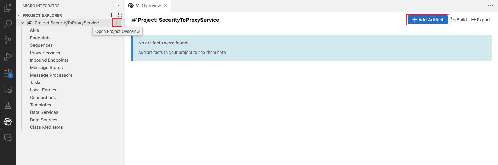
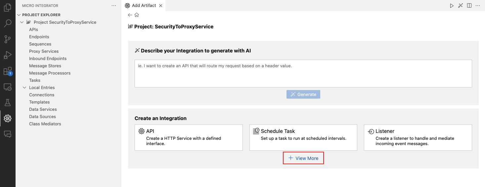
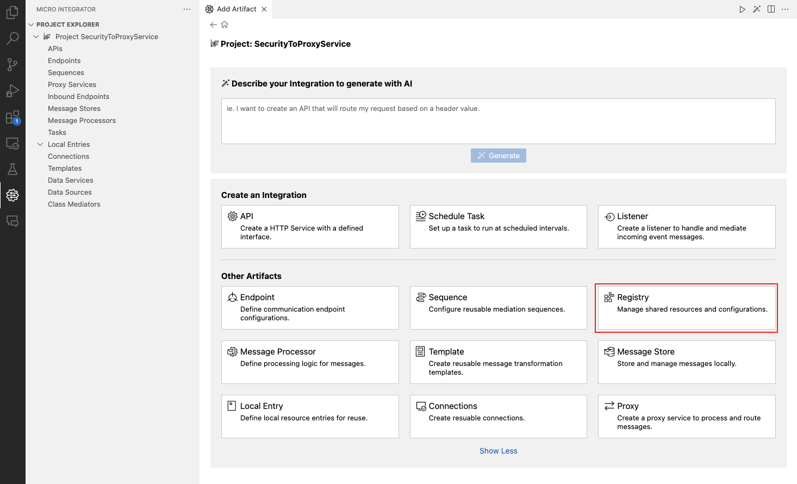
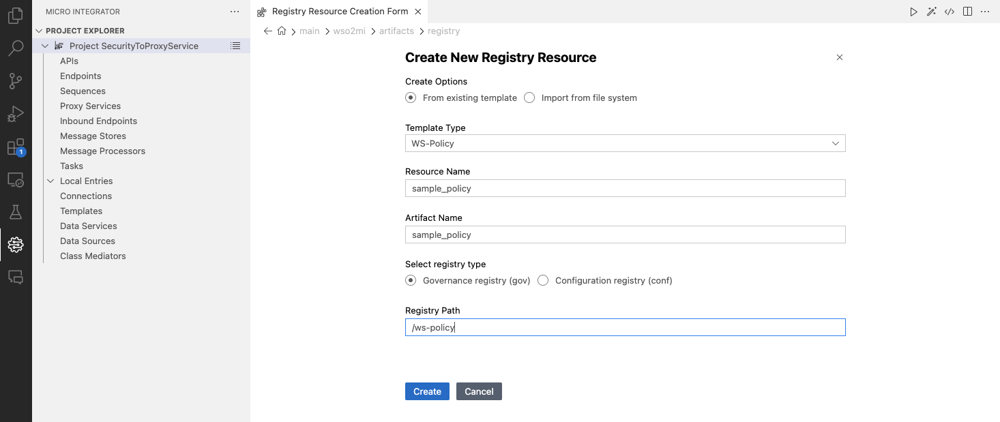
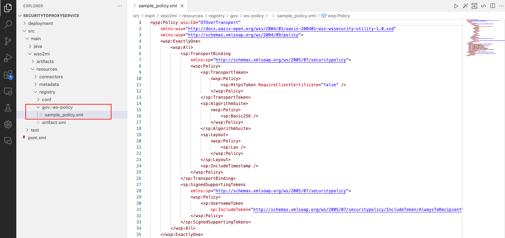
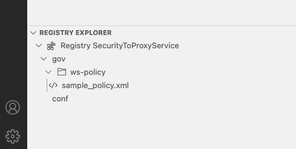
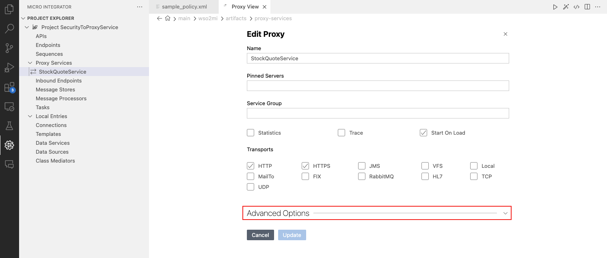
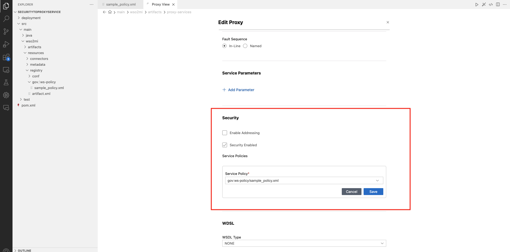

# Apply Security to a Proxy Service

Follow the instructions below to apply security to a proxy service via WSO2 Integration Studio:

<Prerequisites>

## Prerequisites

[configure a user store](/integration/micro-integrator/4.3.0/install-and-setup/setup/user-stores/setting-up-a-userstore) for the Micro Integrator and add the required users and roles.

</Prerequisites>

<Steps>

## Create the security policy file {/* #step-1---create-the-security-policy-file */}

Follow the instructions below to create a **WS-Policy** resource in your integration project. This will be your security policy file.

1. Follow the steps in [create integration project](../create-integration-project.mdx) guide to set up the Integration Project.  
2. Open the project overview and click on **+ Add Artifact**.  
    [](../../../../assets/img/integrate/apply-security/119130870/open-project-overview.png)  
3. Click on **+ View More** to expand the list of artifacts.  
    [](../../../../assets/img/integrate/apply-security/119130870/expand-artifacts-view.png)  
4. Select **Registry** under the **Other Artifacts** section.  
    [](../../../../assets/img/integrate/apply-security/119130870/select-registry-resource.png)  
5. Add the following details in the **Create New Registry Resource** window that opens and click on **Create**.  
    - **Create Options**: Select `From existing template`.   
    - **Template Type**: Select `WS-Policy`.  
    - **Resource Name**: Enter a name for the resource.
    - **Artifact Name**: Enter a name for the artifact.
    - **Select registry type**: Select the registry type where the resource should be saved. Select `Governance registry (gov)` for this example.
    - **Registry Path**: Provide the registry path where the resource should be saved.  
    [](../../../../assets/_versions/4.3.0/img/integrate/apply-security/119130870/create-new-registry-resource.png)  
6. The created policy file will be listed in the project explorer.  
    [](../../../../assets/img/integrate/apply-security/119130870/119130883.png)  
    You can also find this security policy file under the **Registry Explorer** section in the sidebar. Double-click on the file to open it.  
    [](../../../../assets/img/integrate/apply-security/119130870/registry-explorer.png)  

   :::note

   If you want to change any other properties, you can edit via the **Source View**.

   :::

   7. Edit the policy file in the **Source View** to enable the required security scenario.  
      For example, to enable the **Sign and Encrypt** security scenario, add the following encryption/signature properties to the policy file.  
      - **Alias**: `wso2carbon`
      - **Privatestore**: `wso2carbon.jks`
      - **Tenant id**: `-1234`
      - **Truststores**: `wso2carbon.jks`
      - **User**: `wso2carbon`
      
      The following advanced rampart properties have been added to your policy file by default.  
      
      - **User**: `wso2carbon`
      - **encryptionUser**: `useReqSigCert`
      - **timestampPrecisionInMilliseconds**: `true`
      - **timestampTTL**: `300`
      - **timestampMaxSkew**: `300`
      - **timestampStrict**: `false`
      - **tokenStoreClass**: `org.wso2.carbon.security.util.SecurityTokenStore`
      - **nonceLifeTime**: `300`

:::note

Properties in RampartConfig can be externalized using the `$SYSTEM:PROPERTY_NAME` syntax. The `$SYSTEM:` prefix allows you to retrieve values from environment variables.

For example, you can use `$SYSTEM:encryptionUser` to retrieve the value of the `encryptionUser` property from the environment.
```xml
<rampart:RampartConfig xmlns:rampart="http://ws.apache.org/rampart/policy">
    <rampart:encryptionUser>$SYSTEM:encryptionUser</rampart:encryptionUser>
    <rampart:timestampPrecisionInMilliseconds>true</rampart:timestampPrecisionInMilliseconds>
    <rampart:timestampTTL>300</rampart:timestampTTL>
    <rampart:timestampMaxSkew>300</rampart:timestampMaxSkew>
    <rampart:timestampStrict>false</rampart:timestampStrict>
    <rampart:tokenStoreClass>org.wso2.micro.integrator.security.extensions.SecurityTokenStore</rampart:tokenStoreClass>
    <rampart:nonceLifeTime>300</rampart:nonceLifeTime>
</rampart:RampartConfig>
``` 

This approach is useful when you want to externalize configurations and avoid hardcoding values in the policy file.

:::

   The complete policy file with enabled **Sign and Encrypt - X509 Authentication** security scenario will look as follows.
   ```xml
   <wsp:Policy wsu:Id="SigEncr" xmlns:wsp="http://schemas.xmlsoap.org/ws/2004/09/policy" xmlns:wsu="http://docs.oasis-open.org/wss/2004/01/oasis-200401-wss-wssecurity-utility-1.0.xsd">
     <wsp:ExactlyOne>
         <wsp:All>
             <sp:AsymmetricBinding xmlns:sp="http://schemas.xmlsoap.org/ws/2005/07/securitypolicy">
                 <wsp:Policy>
                     <sp:InitiatorToken>
                         <wsp:Policy>
                             <sp:X509Token sp:IncludeToken="http://schemas.xmlsoap.org/ws/2005/07/securitypolicy/IncludeToken/AlwaysToRecipient">
                                 <wsp:Policy>
                                     <sp:RequireThumbprintReference/>
                                     <sp:WssX509V3Token10/>
                                 </wsp:Policy>
                             </sp:X509Token>
                         </wsp:Policy>
                     </sp:InitiatorToken>
                     <sp:RecipientToken>
                         <wsp:Policy>
                             <sp:X509Token sp:IncludeToken="http://schemas.xmlsoap.org/ws/2005/07/securitypolicy/IncludeToken/Never">
                                 <wsp:Policy>
                                     <sp:RequireThumbprintReference/>
                                     <sp:WssX509V3Token10/>
                                 </wsp:Policy>
                             </sp:X509Token>
                         </wsp:Policy>
                     </sp:RecipientToken>
                     <sp:AlgorithmSuite>
                         <wsp:Policy>
                             <sp:Basic256/>
                         </wsp:Policy>
                     </sp:AlgorithmSuite>
                     <sp:Layout>
                         <wsp:Policy>
                             <sp:Strict/>
                         </wsp:Policy>
                     </sp:Layout>
                     <sp:IncludeTimestamp/>
                     <sp:OnlySignEntireHeadersAndBody/>
                 </wsp:Policy>
             </sp:AsymmetricBinding>
             <sp:Wss11 xmlns:sp="http://schemas.xmlsoap.org/ws/2005/07/securitypolicy">
                 <wsp:Policy>
                     <sp:MustSupportRefKeyIdentifier/>
                     <sp:MustSupportRefIssuerSerial/>
                     <sp:MustSupportRefThumbprint/>
                     <sp:MustSupportRefEncryptedKey/>
                     <sp:RequireSignatureConfirmation/>
                 </wsp:Policy>
             </sp:Wss11>
             <sp:Wss10 xmlns:sp="http://schemas.xmlsoap.org/ws/2005/07/securitypolicy">
                 <wsp:Policy>
                     <sp:MustSupportRefKeyIdentifier/>
                     <sp:MustSupportRefIssuerSerial/>
                 </wsp:Policy>
             </sp:Wss10>
             <sp:SignedParts xmlns:sp="http://schemas.xmlsoap.org/ws/2005/07/securitypolicy">
                 <sp:Body/>
             </sp:SignedParts>
             <sp:EncryptedParts xmlns:sp="http://schemas.xmlsoap.org/ws/2005/07/securitypolicy">
                 <sp:Body/>
             </sp:EncryptedParts>
         </wsp:All>
     </wsp:ExactlyOne>
     <rampart:RampartConfig xmlns:rampart="http://ws.apache.org/rampart/policy">
         <rampart:user>wso2carbon</rampart:user>
         <rampart:encryptionUser>useReqSigCert</rampart:encryptionUser>
         <rampart:timestampPrecisionInMilliseconds>true</rampart:timestampPrecisionInMilliseconds>
         <rampart:timestampTTL>300</rampart:timestampTTL>
         <rampart:timestampMaxSkew>300</rampart:timestampMaxSkew>
         <rampart:timestampStrict>false</rampart:timestampStrict>
         <rampart:tokenStoreClass>org.wso2.carbon.security.util.SecurityTokenStore
         </rampart:tokenStoreClass>
         <rampart:nonceLifeTime>300</rampart:nonceLifeTime>
         <rampart:encryptionCrypto>
             <rampart:crypto cryptoKey="org.wso2.carbon.security.crypto.privatestore" provider="org.wso2.carbon.security.util.ServerCrypto">
                 <rampart:property name="org.wso2.carbon.security.crypto.alias">wso2carbon</rampart:property>
                 <rampart:property name="org.wso2.carbon.security.crypto.privatestore">wso2carbon.jks</rampart:property>
                 <rampart:property name="org.wso2.stratos.tenant.id">-1234</rampart:property>
                 <rampart:property name="org.wso2.carbon.security.crypto.truststores">wso2carbon.jks</rampart:property>
                 <rampart:property name="rampart.config.user">wso2carbon</rampart:property>
             </rampart:crypto>
         </rampart:encryptionCrypto>
         <rampart:signatureCrypto>
             <rampart:crypto cryptoKey="org.wso2.carbon.security.crypto.privatestore" provider="org.wso2.carbon.security.util.ServerCrypto">
                 <rampart:property name="org.wso2.carbon.security.crypto.alias">wso2carbon</rampart:property>
                 <rampart:property name="org.wso2.carbon.security.crypto.privatestore">wso2carbon.jks</rampart:property>
                 <rampart:property name="org.wso2.stratos.tenant.id">-1234</rampart:property>
                 <rampart:property name="org.wso2.carbon.security.crypto.truststores">wso2carbon.jks</rampart:property>
                 <rampart:property name="rampart.config.user">wso2carbon</rampart:property>
             </rampart:crypto>
         </rampart:signatureCrypto>
     </rampart:RampartConfig>
   </wsp:Policy>
   ```
    
:::info

- Change the tokenStoreClass in the policy file to `org.wso2.micro.integrator.security.extensions.SecurityTokenStore`
    
- Replace ServerCrypto class with `org.wso2.micro.integrator.security.util.ServerCrypto` if present.

:::
        

## Add the security policy to the proxy service {/* #step-2---add-the-security-policy-to-the-proxy-service */}

1.  Add a proxy service to your workspace.

     You can do either one of the following actions for this purpose.

    - [Create a new proxy service](../creating-artifacts/creating-a-proxy-service.mdx)
    - [Import an existing proxy service](/integration/micro-integrator/4.3.0/develop/importing-artifacts)

2.  Click the proxy service on the project explorer to open the design view and click on **Edit** to open the form view.

3. Click on **Advanced Options** and navigate to the **Security** section.

    [](../../../../assets/img/integrate/apply-security/119130870/edit-proxy-service-advanced-options.png)  

4. Select the **Security Enabled** checkbox and click on the **+ Add Policy** to select the security policy file you created in the previous step.

    [](../../../../assets/img/integrate/apply-security/119130870/enable-security.png)  

    Select the security policy file from the drop-down list and click **Save**.

## Build and run the artifacts {/* #step-3---build-and-run-the-artifacts */}

To deploy and run the project, refer the [build and run](../deploy-artifacts.mdx#build-and-run) guide.

## Test the service {/* #step-4---test-the-service */}

Create a Soap UI project with the relevant security settings and then send the request to the hosted service.

### General guidelines on testing with SOAP UI

1.  Create a "SOAP Project" in SOAP UI using the WSDL URL of the proxy service.

     Example: `http://localhost:8280/services/SampleProxy?wsdl`

    

2.  Double-click on the created SOAP project, click on **WS-Security-Configuration**, **Keystores**, and add the WSO2 keystore.

    
    
3.  Enter the keystore password for the keystore configuration.

4.  Click on **Outgoing WS-Security Configuration**, and add a new policy by specifying a name. 

     The name can be anything.

    
    
5.  Add the required WSS entries for the created configuration.
   
     What you need add will vary according to the policy you are using. The explanation about adding three main sections is given below.

    - **Adding a Signature**  
    
         <a href="/integration/micro-integrator/assets/img/integrate/apply-security/soapui/adding-signature-entry.jpg"></a>
    
    - **Adding a Timestamp**
    
         <a href="/integration/micro-integrator/assets/img/integrate/apply-security/soapui/adding-timestamp-entry.jpg"></a>
    
    - **Adding an Encryption**
    
         <a href="/integration/micro-integrator/assets/img/integrate/apply-security/soapui/adding-encryption-entry.jpg"></a>
    
    :::note

    The order of the WS entries matters. So always add the above one after the other. If you are adding only two sections, you need to maintain the order.

    :::
        
6.  Specify the created WS-policy under **Outgoing WSS** at the request **Authorization**.

    <a href="/integration/micro-integrator/assets/img/integrate/apply-security/soapui/invoking-with-out-policy.jpg"></a>
   
7.  Invoke the Proxy Service.

    :::info


    When defining the Outgoing WS-Security Configuration, you need to pick the WS entries based on your WS policy.

    Eg:

    - A Non Repudiation policy needs only Timestamp and Signature. 
    - A Confidentiality policy needs all three: Timestamp, Signature and Encryption.
    - You do not need to provide an Outgoing WS-Security Configuration for a Username Token policy. Providing the basic auth configuration is enough.

    <a href="/integration/micro-integrator/assets/img/integrate/apply-security/soapui/invoking-username-token.jpg"></a>

    :::

8.  To decrypt the response, add the Incoming WSS configuration similar to the Outgoing WSS configuration.

    <a href="/integration/micro-integrator/assets/img/integrate/apply-security/soapui/adding-decryption-entry.png"></a>

9.  Invoke the Proxy Service with Incoming & Outgoing WSS Configuration.

    <a href="/integration/micro-integrator/assets/img/integrate/apply-security/soapui/invoking-with-out-in-policy.png"></a>

</Steps>
