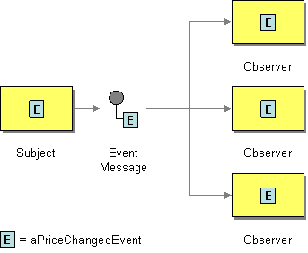
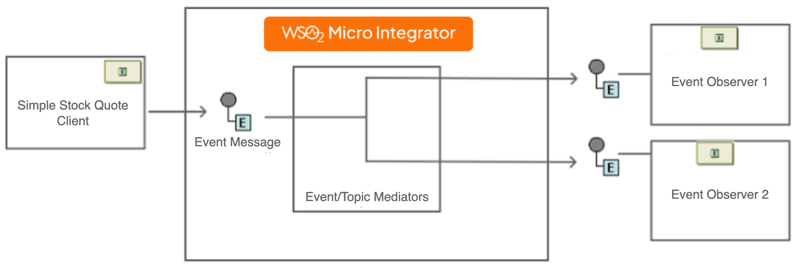

# Event Message

This page explains how you can implement a sample scenario of Event Message using WSO2 Micro Integrator.

## Introduction to Event Message

The Event Message EIP is used for reliable, asynchronous event notifications between applications. 

:::info

For more information, see the [Event Message](http://www.eaipatterns.com/EventMessage.html).

:::



## Sample scenario

The example scenario depicts an inventory for stocks and demonstrates how the EIP distributes a message among several subscribers. It includes multiple instances of the subscribers for the event. When a message is sent to the WSO2 MI, it is transmitted to these subscriber instances, each of which acts as a subscriber through the ActiveMQ topic.

The diagram below depicts how to simulate the example scenario using the WSO2 MI.



Before digging into implementation details, let's take a look at the relationship between the example scenario and the Event Message EIP by comparing their core components.

| Event Message EIP            | Event Message Example Scenario            |
|------------------------------|-------------------------------------------|
| Subject                      | Stock Quote Client                        |
| Event Message                | ActiveMQ topic                            |
| Observer                     | EventObserver Proxies                     |

## Synapse configuration of the artifacts

<Tabs>
<TabItem value="tab-0" label="EventGeneratorProxy">

```xml
<?xml version="1.0" encoding="UTF-8"?>
<proxy name="EventGeneratorProxy" transports="http" startOnLoad="true" trace="disable" xmlns="http://ws.apache.org/ns/synapse">
   <target>
      <inSequence>
         <property name="OUT_ONLY" value="true" />
         <property name="FORCE_SC_ACCEPTED" value="true" scope="axis2" />
         <call>
           <endpoint>
               <address uri="jms:/SimpleStockQuoteService?transport.jms.ConnectionFactory=myTopicSender"/>
           </endpoint>
         </call>
      </inSequence>
   </target>
</proxy>
```

</TabItem>
<TabItem value="tab-1" label="EventObserver1">

```xml
<?xml version="1.0" encoding="UTF-8"?>
<proxy name="EventObserver1" transports="jms" startOnLoad="true" trace="disable" xmlns="http://ws.apache.org/ns/synapse">
   <target>
       <inSequence>
          <log category="INFO" level="custom">
              <property name="Observer1" expression="$body" />
          </log>
          <drop/>
        </inSequence>
   </target>
   <parameter name="transport.jms.ContentType">
      <rules>
         <jmsProperty>contentType</jmsProperty>
         <default>application/xml</default>
      </rules>
   </parameter>
   <parameter name="transport.jms.ConnectionFactory">myTopicConnectionFactory</parameter>
   <parameter name="transport.jms.DestinationType">topic</parameter>
   <parameter name="transport.jms.Destination">SimpleStockQuoteService</parameter>
</proxy>
```

</TabItem>
<TabItem value="tab-2" label="EventObserver2">

```xml
<?xml version="1.0" encoding="UTF-8"?>
<proxy name="EventObserver2" transports="jms" startOnLoad="true" trace="disable" xmlns="http://ws.apache.org/ns/synapse">
    <target>
        <inSequence>
           <log level="custom">
           <property name="Observer2" value="Event received by the Observer2"/>
           </log>
           <log category="INFO" level="custom">
              <property name="Observer2" expression="$body" />
           </log>
           <drop/>
        </inSequence>
    </target>
    <parameter name="transport.jms.ContentType">
        <rules>
           <jmsProperty>contentType</jmsProperty>
           <default>application/xml</default>
        </rules>
    </parameter>
    <parameter name="transport.jms.ConnectionFactory">myTopicConnectionFactory</parameter>
    <parameter name="transport.jms.DestinationType">topic</parameter>
    <parameter name="transport.jms.Destination">SimpleStockQuoteService</parameter>
</proxy>
```

</TabItem>
</Tabs>

## Set up the sample scenario

1. Install WSO2 Micro Integrator.

    :::info

    Follow the [Install the Micro Integrator Runtime](https://mi.docs.wso2.com/en/latest/install-and-setup/install/installing-mi/) documentation for more information.

    :::

2. Launch Visual Studio Code with the Micro Integrator for VS Code extension (MI for VS Code) installed.

    :::info

    Follow the [Install Micro Integrator for VS Code](https://mi.docs.wso2.com/en/latest/develop/mi-for-vscode/install-wso2-mi-for-vscode/) documentation for a complete installation guide.

    :::
    

4. Download the artifacts of the sample.

    <a href="/integration/micro-integrator/assets/attachments/learn/enterprise-integration-patterns/EventMessage.zip">
    </a>

5. Import the artifacts to WSO2 MI.

    Click **File** -> **Open Folder** -> Select the extracted ZIP file to import the downloaded ZIP file.

6. Start the project in the WSO2 MI server.

    For instructions, go to [Build and Run](../../../develop/deploy-artifacts.mdx#build-and-run) Documentation.

7. Set up and Start [ActiveMQ](../../../install-and-setup/setup/brokers/configure-with-activemq.mdx).

!!!note
    Make sure to configure the relevant [JMS parameters](../../../reference/synapse-properties/transport-parameters/jms-transport-parameters.mdx) in the `deployment.toml` file.
    ```
    [[transport.jms.listener]]
    name = "myTopicConnectionFactory"
    parameter.initial_naming_factory = "org.apache.activemq.jndi.ActiveMQInitialContextFactory"
    parameter.provider_url = "tcp://localhost:61616"
    parameter.connection_factory_name = "TopicConnectionFactory"
    parameter.connection_factory_type = "topic"

    [[transport.jms.sender]]
    name = "myTopicSender"
    parameter.initial_naming_factory = "org.apache.activemq.jndi.ActiveMQInitialContextFactory"
    parameter.provider_url = "tcp://localhost:61616"
    parameter.connection_factory_name = "TopicConnectionFactory"
    parameter.connection_factory_type = "topic"
    ```


## Execute the sample

Send the following request to the service using SoapUI (or any other SOAP client).

```xml
POST http://localhost:8290/services/EventGeneratorProxy

Content-Type: text/xml;charset=UTF-8
SOAPAction: "urn:getQuote"

<soapenv:Envelope xmlns:soapenv="http://schemas.xmlsoap.org/soap/envelope/" xmlns:ser="http://services.samples" xmlns:xsd="http://services.samples/xsd">
<soapenv:Body>
    <ser:getQuote>
        <ser:request>
            <xsd:symbol>IBM</xsd:symbol>
        </ser:request>
    </ser:getQuote>
</soapenv:Body>
</soapenv:Envelope>
```

## Analyze the output

When you execute the command above, a message is sent to the ActiveMQ topic. Notice the following processed server log in WSO2 MI output:

```log
INFO {LogMediator} - {proxy:EventObserver2} Observer2 = <soapenv:Body xmlns:soapenv="http://schemas.xmlsoap.org/soap/envelope/">
      <ser:getQuote xmlns:ser="http://services.samples">    
         <ser:request>          
            <xsd:symbol xmlns:xsd="http://services.samples/xsd">IBM</xsd:symbol>
         </ser:request>
      </ser:getQuote>
   </soapenv:Body>
INFO {LogMediator} - {proxy:EventObserver1} Subscriber1 = <soapenv:Body xmlns:soapenv="http://schemas.xmlsoap.org/soap/envelope/"><soapenv:Envelope xmlns:xsd="http://services.samples/xsd" xmlns:ser="http://services.samples"><soapenv:Body>
      <ser:getQuote>    
         <ser:request>          
            <xsd:symbol>IBM</xsd:symbol>
         </ser:request>
      </ser:getQuote>
   </soapenv:Body></soapenv:Envelope></soapenv:Body>
```
