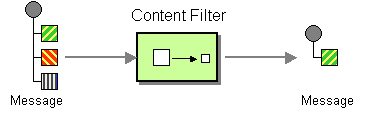

# Content Filter

This page explains how you can implement a sample scenario of the Content Filter EIP using the WSO2 Micro Integrator.

## Introduction to Content Filter

The Content Filter EIP helps manage a large message when you are interested in only a few data items. It removes unimportant data items from a message and leaves only the important ones. In addition to removing data elements, a Content Filter can be used to simplify a message structure. 

:::info

For more information, see the [Content Filter](http://www.eaipatterns.com/ContentFilter.html) documentation.

:::



## Sample scenario

This example scenario explains how a message's content can be optimized to gain a more productive response. A client sends a stock quote request containing additional data that is not necessary for message processing. WSO2 MI uses an XSLT mediator to restructure the request message and optimize it with only the required data before sending it to the Stock Quote service. This approach improves performance, as removing unnecessary bits of data makes the message more lightweight.

The diagram below depicts how to simulate the example scenario in WSO2 MI.


Before digging into implementation details, let's take a look at the relationship between the example scenario and the Content Filter EIP by comparing their core components.

| Content Filter EIP            | Content Filter Sample Scenario            |
|-------------------------------|-------------------------------------------|
| Original Message              | Simple Stock Quote Request from Client    |
| Content Filter                | XSLT Mediator                             |
| Filtered Message              | Simple Stock Quote Request from WSO2 MI   |

## Synapse configuration of the artifacts

Given below is the synapse configuration of this sample.

<Tabs>
<TabItem value="tab-0" label="Proxy Service">

```xml
<?xml version="1.0" encoding="UTF-8"?>
<proxy name="ContentFilterProxy" startOnLoad="true" transports="http https" xmlns="http://ws.apache.org/ns/synapse">
    <target>
        <inSequence>
            <xslt key="gov:split_message.xslt">
            </xslt>
            <log category="INFO" level="full"/>
            <call>
                <endpoint key="SimpleStockEp"/>
            </call>
            <log category="INFO" level="full"/>
            <respond/>
        </inSequence>
        <faultSequence/>
    </target>
</proxy>
```

</TabItem>
<TabItem value="tab-1" label="Endpoint">

```xml
<?xml version="1.0" encoding="UTF-8"?>
<endpoint name="SimpleStockEp" xmlns="http://ws.apache.org/ns/synapse">
    <address uri="http://localhost:9001/services/SimpleStockQuoteService">
        <suspendOnFailure>
            <initialDuration>-1</initialDuration>
            <progressionFactor>1</progressionFactor>
        </suspendOnFailure>
        <markForSuspension>
            <retriesBeforeSuspension>0</retriesBeforeSuspension>
        </markForSuspension>
    </address>
</endpoint>
```

</TabItem>
<TabItem value="tab-2" label="Registry Resource">

```xslt
<?xml version="1.0" encoding="ISO-8859-1"?>
<xsl:stylesheet version="2.0"
                xmlns:xsl="http://www.w3.org/1999/XSL/Transform"
                xmlns:fn="http://www.w3.org/2005/02/xpath-functions"
                xmlns:m0="http://services.samples"
                exclude-result-prefixes="m0 fn">
    <xsl:output method="xml" omit-xml-declaration="yes" indent="yes"/>
    <xsl:template match="/">   
        <m:getQuote xmlns:m="http://services.samples">
            <m:request>
                <m:symbol> 
                    <xsl:value-of select="normalize-space(//m0:getQuote/m0:request[1])"/>
                </m:symbol> 
            </m:request>
        </m:getQuote> 
    </xsl:template>
</xsl:stylesheet>
```

</TabItem>
</Tabs>

:::info

Create the Registry Resource in `gov:split_message.xslt`. For further details, refer to the [Create a Registry Resource](../../../develop/creating-artifacts/creating-registry-resources.mdx) Documentation. 

:::

Let's investigate the elements of the configuration in detail. 

- localEntry - Entry from the local registry.
- xslt - The XSLT mediator applies an XSLT transformation to the selected element in the message specified using the source attribute. In this case, no source attribute is given, so the transformation will be applied to the first child element of the message. 

## Set up the sample scenario

Follow the below instructions to simulate this sample scenario.

1. Install WSO2 Micro Integrator.

    :::info

    Follow the [Install the Micro Integrator Runtime](https://mi.docs.wso2.com/en/latest/install-and-setup/install/installing-mi/) documentation for more information.

    :::

2. Launch Visual Studio Code with the Micro Integrator for VS Code extension (MI for VS Code) installed.

    :::info

    Follow the [Install Micro Integrator for VS Code](https://mi.docs.wso2.com/en/latest/develop/mi-for-vscode/install-wso2-mi-for-vscode/) documentation for a complete installation guide.

    :::
    

3. Download the [backend service](https://github.com/wso2-docs/WSO2_EI/blob/master/Back-End-Service/axis2Server.zip).

4. Extract the downloaded zip file.

5. Open a terminal, and navigate to the `axis2Server/bin/` directory inside the extracted folder.

6. Execute the following command to start the axis2server with the SimpleStockQuote backend service:

    <Tabs>
    <TabItem value="tab-0" label="On MacOS/Linux">

      ```bash
      sh axis2server.sh
      ```

    </TabItem>
    <TabItem value="tab-1" label="On Windows">

      ```bash
      axis2server.bat
      ``` 

    </TabItem>
    </Tabs>

7. Navigate to the `MI_HOME/bin/` directory and start the `tcpmon` application. 

    For instructions, go to [Starting TCPMon](../../../observe-and-manage/classic-observability-tcp/starting-tcp-mon.mdx) Documentation.

8. In the `tcpmon` application, navigate to the **Admin** tab. Add a listener to the port `9001`, and set the **target hostname** to `localhost` and **target port** to `9000`.

9. Download the artifacts of the sample.

    <a href="/integration/micro-integrator/assets/attachments/learn/enterprise-integration-patterns/ContentFilter.zip">
        
    </a>

10. Import the artifacts to WSO2 MI.

    Click **File** -> **Open Folder** -> Select the extracted ZIP file to import the downloaded ZIP file.

11. Start the project in the WSO2 MI server.

    For instructions, go to [Build and Run](../../../develop/deploy-artifacts.mdx#build-and-run) Documentation.

## Execute the sample

Send the following request to the above proxy service.

```
POST /services/ContentFilterProxy HTTP/1.1
Host: localhost:8290
Content-Type: application/xml

<soapenv:Envelope xmlns:soapenv="http://schemas.xmlsoap.org/soap/envelope/" xmlns:ser="http://services.samples" xmlns:xsd="http://services.samples/xsd">
    <soapenv:Header/>
    <soapenv:Body>
        <ser:getQuote>
            <ser:request>
                <ser:symbol>1</ser:symbol>
            </ser:request>
            <ser:request>
                <ser:symbol>2</ser:symbol>
            </ser:request>
            <ser:request>
                <ser:symbol>3</ser:symbol>
            </ser:request>
        </ser:getQuote>
    </soapenv:Body>
</soapenv:Envelope>
```

## Analyze the output

When a request arrives at the WSO2 MI, it is first simplified using the XSLT mediator. When the request was monitored through TCPMon, the request sent to the backend Axis2 server had the following structure:

```
POST /services/SimpleStockQuoteService HTTP/1.1
activityid: c97b9d66-f3ef-4dbe-8c6d-b944154b91b0
Accept: */*
Content-Type: application/xml
Transfer-Encoding: chunked
Host: localhost:9001
Connection: Keep-Alive
User-Agent: Synapse-PT-HttpComponents-NIO

78
<m:getQuote xmlns:m="http://services.samples">
   <m:request>
      <m:symbol>1</m:symbol>
   </m:request>
</m:getQuote>
0
```
