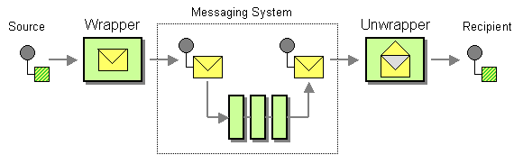

# Envelope Wrapper

This page explains how you can implement a sample scenario of the Envelope Wrapper EIP using WSO2 Micro Integrator.

## Introduction to Envelope Wrapper

The Envelope Wrapper EIP allows existing systems to participate in a messaging exchange that places specific requirements on the message format, such as message header fields or encryption. It wraps application data inside an envelope that is compliant with the messaging infrastructure. The message is unwrapped when it arrives at the destination. 

:::info

For more information, see the [Envelope Wrapper](http://www.eaipatterns.com/EnvelopeWrapper.html) documentation.

:::



## Sample scenario

This example scenario receives a message with application data wrapped inside an envelope, unwraps the message, and sends it to a specific endpoint. The sender sends the request inside a SOAP envelope. Once the WSO2 MI receives the envelope, it unwraps it and sends it as a Plain Old XML (POX) request to the sample backend Axis2 server.

The diagram below depicts how to simulate the example scenario using the WSO2 MI.


Before digging into implementation details, let's take a look at the relationship between the example scenario and the Envelope Wrapper EIP by comparing their core components.

| Envelope Wrapper EIP            | Envelope Wrapper Sample Scenario             |
|---------------------------------|----------------------------------------------|
| Wrapper                         | Stock Quote Request wrapped in SOAP          |
| Messaging                       | WSO2 MI                                      |
| Unwrapper                       | Address Endpoint format                      |
| Recipient                       | Stock Quote Service Instance                 |

:::note

An alternative implementation of this EIP is to have the Address Endpoint wrap from one envelope format to another (for example, wrapping a SOAP 1.1 envelope in a SOAP 1.2 envelope).

:::

## Synapse configuration of the artifacts

Given below is the synapse configuration of this sample.

<Tabs>
<TabItem value="tab-0" label="Proxy Service">

```xml
<?xml version="1.0" encoding="UTF-8"?>
<proxy name="EnvelopeUnwrapProxy" startOnLoad="true" transports="http https" xmlns="http://ws.apache.org/ns/synapse">
    <target>
        <inSequence>
            <call>
                <endpoint key="SimpleStockEp"/>
            </call>
            <respond/>
        </inSequence>
        <faultSequence/>
    </target>
</proxy>
```

</TabItem>
<TabItem value="tab-1" label="Endpoint">

```xml
<?xml version="1.0" encoding="UTF-8"?>
<endpoint name="SimpleStockEp" xmlns="http://ws.apache.org/ns/synapse">
    <address format="pox" uri="http://localhost:9001/services/SimpleStockQuoteService">
        <suspendOnFailure>
        <initialDuration>-1</initialDuration>
        <progressionFactor>1</progressionFactor>
        </suspendOnFailure>
        <markForSuspension>
        <retriesBeforeSuspension>0</retriesBeforeSuspension>
        </markForSuspension>
    </address>
</endpoint>
```

</TabItem>
</Tabs>

Let's investigate the elements of the configuration in detail.

- **address** - The endpoint address contains the attribute format `pox`, which makes the WSO2 MI convert incoming requests to Plain Old XML. Other supported formats for wrapping include soap11, soap12, etc. For more information, refer to the [Endpoint Basic Properties](../../../reference/synapse-properties/endpoint-properties.mdx#basic-properties) Documentation.

## Set up the sample scenario

Follow the below instructions to simulate this sample scenario.

1. Install WSO2 Micro Integrator.

    :::info

    Follow the [Install the Micro Integrator Runtime](https://mi.docs.wso2.com/en/latest/install-and-setup/install/installing-mi/) documentation for more information.

    :::

2. Launch Visual Studio Code with the Micro Integrator for VS Code extension (MI for VS Code) installed.

    :::info

    Follow the [Install Micro Integrator for VS Code](https://mi.docs.wso2.com/en/latest/develop/mi-for-vscode/install-wso2-mi-for-vscode/) documentation for a complete installation guide.

    :::
    

3. Download the [backend service](https://github.com/wso2-docs/WSO2_EI/blob/master/Back-End-Service/axis2Server.zip).

4. Extract the downloaded zip file.

5. Open a terminal, and navigate to the `axis2Server/bin/` directory inside the extracted folder.

6. Execute the following command to start the axis2server with the SimpleStockQuote backend service:

    <Tabs>
    <TabItem value="tab-0" label="On MacOS/Linux">

      ```bash
      sh axis2server.sh
      ```

    </TabItem>
    <TabItem value="tab-1" label="On Windows">

      ```bash
      axis2server.bat
      ``` 

    </TabItem>
    </Tabs>

7. Navigate to the `MI_HOME/bin/` directory and start the `tcpmon` application. 

    For instructions, go to [Starting TCPMon](../../../observe-and-manage/classic-observability-tcp/starting-tcp-mon.mdx) Documentation.

8. In the `tcpmon` application, navigate to the **Admin** tab. Add a listener to the port `9001`, and set the **target hostname** to `localhost` and **target port** to `9000`.

9. Download the artifacts of the sample.

   <a href="/integration/micro-integrator/assets/attachments/learn/enterprise-integration-patterns/EnvelopeWrapper.zip">
        
    </a>

10. Import the artifacts to WSO2 MI.

    Click **File** -> **Open Folder** -> Select the extracted ZIP file to import the downloaded ZIP file.

11. Start the project in the WSO2 MI server.

    For instructions, go to [Build and Run](../../../develop/deploy-artifacts.mdx#build-and-run) Documentation.

## Execute the sample

Send the following request to the above proxy service.

```
POST /services/EnvelopeUnwrapProxy HTTP/1.1
Host: localhost:8290
Content-Type: text/xml
soapAction: urn:getQuote

<soapenv:Envelope xmlns:soapenv="http://schemas.xmlsoap.org/soap/envelope/" xmlns:ser="http://services.samples" xmlns:xsd="http://services.samples/xsd">
   <soapenv:Header/>
   <soapenv:Body>
      <ser:getQuote>    
         <ser:request>          
            <xsd:symbol>foo</xsd:symbol>
         </ser:request>       
      </ser:getQuote>
   </soapenv:Body>
</soapenv:Envelope>
```

## Analyze the output

The request data is enclosed within a SOAP envelope. When it is sent to the proxy service, TCPMon captures and forwards it to the backend Axis2 server. By using TCPMon, we can observe the request in the following structure:

```
POST /services/SimpleStockQuoteService HTTP/1.1
Cookie: CookieConsentPolicy=0:1; LSKey-c$CookieConsentPolicy=0:1
activityid: b3575dab-ad7c-4445-94b0-74671b1c232c
Accept: */*
Cache-Control: no-cache
Postman-Token: 224cb9d0-c01b-4472-896e-f14245ef523e
Accept-Encoding: gzip, deflate, br
Content-Type: application/xml
SOAPAction: urn:getQuote
Transfer-Encoding: chunked
Host: localhost:9001
Connection: Keep-Alive
User-Agent: Synapse-PT-HttpComponents-NIO

dd
<ser:getQuote xmlns:ser="http://services.samples">    
   <ser:request>          
      <xsd:symbol xmlns:xsd="http://services.samples/xsd">foo</xsd:symbol>
   </ser:request>       
</ser:getQuote>
0
```

This means that the SOAP envelope was removed by the WSO2 MI.
