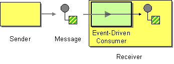

# Event-Driven Consumer

This page explains how you can implement a sample scenario of the Event-Driven Consumer EIP using WSO2 Micro Integrator.

## Introduction to Event-Driven Consumer

The Event-Driven Consumer EIP allows an application to asynchronously consume messages as they become available. 

:::info

For more information, see the [Event-Driven Consumer](http://www.eaipatterns.com/EventDrivenConsumer.html) documentation.

:::



## Sample scenario

This EIP is also referred to as an asynchronous receiver. This sample scenario demonstrates how an event will be triggered based on the availability of the receiver and a message will be consumed by the receiver.

The diagram below depicts how to simulate the sample scenario using the WSO2 MI.


Before digging into implementation details, let's take a look at the relationship between the sample scenario and the Event-Driven Consumer EIP by comparing their core components.

| Event-Driven Consumer EIP            | Event-Driven Consumer Sample Scenario            |
|--------------------------------------|--------------------------------------------------|
| Sender                               | Simple Stock Quote Client                        |
| Message                              | Simple Stock Quote Request                       |
| Event Driven Consumer                | Message Processor                                |
| Receiver                             | Simple Stock Quote Service                       |

## Synapse configuration of the artifacts

Given below is the synapse configuration of this sample. 

<Tabs>
<TabItem value="tab-0" label="Proxy Service">

```xml
<?xml version="1.0" encoding="UTF-8"?>
<proxy name="EventDrivenConsumerProxy" startOnLoad="true" transports="http https" xmlns="http://ws.apache.org/ns/synapse">
    <target>
        <inSequence>
            <property name="FORCE_SC_ACCEPTED" value="true" scope="axis2"/>
            <property name="OUT_ONLY" value="true"/>
            <store messageStore="EventDrivenConsumerStore"/>
        </inSequence>
        <faultSequence/>
    </target>
</proxy>
```

</TabItem>
<TabItem value="tab-1" label="Message Store">

```xml
<?xml version="1.0" encoding="UTF-8"?>
<messageStore name="EventDrivenConsumerStore" class="org.apache.synapse.message.store.impl.memory.InMemoryStore" xmlns="http://ws.apache.org/ns/synapse">
</messageStore>
```

</TabItem>
<TabItem value="tab-2" label="Message Processor">

```xml
<?xml version="1.0" encoding="UTF-8"?>
<messageProcessor class="org.apache.synapse.message.processor.impl.sampler.SamplingProcessor" name="EventDrivenConsumerProcessor" messageStore="EventDrivenConsumerStore" xmlns="http://ws.apache.org/ns/synapse">
    <parameter name="sequence">SendSeq</parameter>
    <parameter name="interval">1000</parameter>
    <parameter name="is.active">true</parameter>
    <parameter name="concurrency">1</parameter>
</messageProcessor>
```

</TabItem>
<TabItem value="tab-3" label="Endpoint">

```xml
<?xml version="1.0" encoding="UTF-8"?>
<endpoint name="SimpleStockEp" xmlns="http://ws.apache.org/ns/synapse">
    <address uri="http://localhost:9000/services/SimpleStockQuoteService">
        <suspendOnFailure>
            <initialDuration>-1</initialDuration>
            <progressionFactor>1</progressionFactor>
        </suspendOnFailure>
        <markForSuspension>
            <retriesBeforeSuspension>0</retriesBeforeSuspension>
        </markForSuspension>
    </address>
</endpoint>
```

</TabItem>
<TabItem value="tab-4" label="Sequence">

```xml
<?xml version="1.0" encoding="UTF-8"?>
<sequence name="SendSeq" trace="disable" xmlns="http://ws.apache.org/ns/synapse">
    <call>
        <endpoint key="SimpleStockEp"/>
    </call>
</sequence>
```

</TabItem>
</Tabs>

Let's investigate the elements of the configuration in detail. 

- **store** - The store mediator loads the message store. 
- **messageStore** - Defines the message store to use. 
- **messageProcessor** - Defines the processing algorithm for stored messages. 

## Set up the sample scenario

1. Install WSO2 Micro Integrator.

    :::info

    Follow the [Install the Micro Integrator Runtime](https://mi.docs.wso2.com/en/latest/install-and-setup/install/installing-mi/) documentation for more information.

    :::

2. Launch Visual Studio Code with the Micro Integrator for VS Code extension (MI for VS Code) installed.

    :::info

    Follow the [Install Micro Integrator for VS Code](https://mi.docs.wso2.com/en/latest/develop/mi-for-vscode/install-wso2-mi-for-vscode/) documentation for a complete installation guide.

    :::
    

3. Download the [backend service](https://github.com/wso2-docs/WSO2_EI/blob/master/Back-End-Service/axis2Server.zip).

4. Extract the downloaded zip file.

5. Open a terminal, and navigate to the `axis2Server/bin/` directory inside the extracted folder.

6. Execute the following command to start the axis2server with the SimpleStockQuote backend service:

    <Tabs>
    <TabItem value="tab-0" label="On MacOS/Linux">

      ```bash
      sh axis2server.sh
      ```

    </TabItem>
    <TabItem value="tab-1" label="On Windows">

      ```bash
      axis2server.bat
      ```

    </TabItem>
    </Tabs>

7. Download the artifacts of the sample.

    <a href="/integration/micro-integrator/assets/attachments/learn/enterprise-integration-patterns/EventDrivenConsumer.zip">
        
    </a>

8. Import the artifacts to WSO2 MI.

    Click **File** -> **Open Folder** -> Select the extracted ZIP file to import the downloaded ZIP file.

9. Start the project in the WSO2 MI server.

    For instructions, go to [Build and Run](../../../develop/deploy-artifacts.mdx#build-and-run) Documentation.

## Execute the sample

Send the following request to the `EventDrivenConsumerProxy` service.

```
POST /services/EventDrivenConsumerProxy HTTP/1.1
Host: localhost:8290
Content-Type: text/xml
soapAction: urn:getQuote

<soapenv:Envelope xmlns:soapenv="http://schemas.xmlsoap.org/soap/envelope/" xmlns:ser="http://services.samples" xmlns:xsd="http://services.samples/xsd">
   <soapenv:Header/>
   <soapenv:Body>
      <ser:getQuote>
         <ser:request>
            <xsd:symbol>foo</xsd:symbol>
         </ser:request>
      </ser:getQuote>
   </soapenv:Body>
</soapenv:Envelope>
```

## Analyze the output

After the request is sent, it will be stored in the configured [Message Store](../../examples/message-store-processor-examples/intro-message-stores-processors.mdx). The [Sampling Message Processor](../../examples/message-store-processor-examples/using-message-sampling-processor.mdx) will then retrieve the request from the store and send it to the axis2server. A message similar to the one shown below will appear in the axis2server, indicating that the request has been accepted.

```
Fri Aug 16 14:02:22 IST 2024 samples.services.SimpleStockQuoteService :: Generating quote for : foo
```
