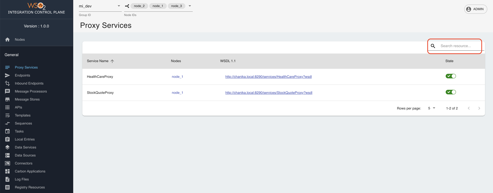
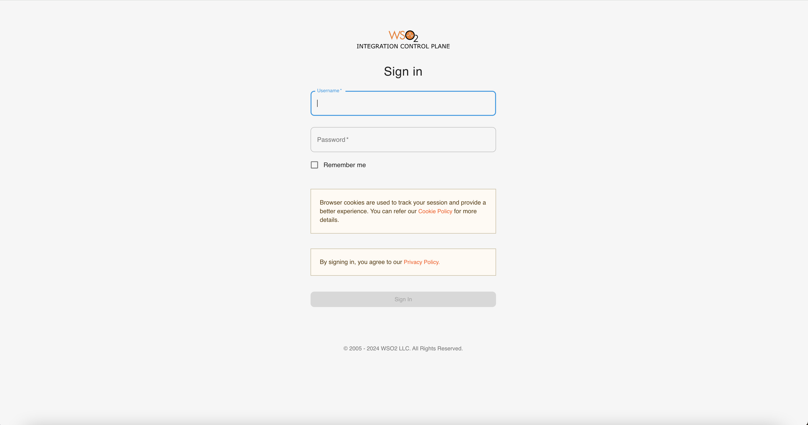

# Monitoring MI Artifacts and Logs

The WSO2 Integration Control Plane (ICP) monitors the MI instances in a deployment. This can be a single MI instance or multiple MI instances in a group (cluster). It provides a graphical view of the integration artifacts that are deployed in the MI instances. You can also perform various management 
and administration tasks using the ICP server. 

The ICP server communicates with the management APIs of each Micro Integrator instance in the group (cluster) to get and manipulate data.

## Capabilities of the ICP server

You can use the ICP server to perform the following administration tasks related to your Micro Integrator deployment:

:::tip

You can search for certain artifacts using the specific name of the artifact if there are many such items in the list.

    

:::

-   <b>View the MI servers in the deployment</b>

    View basic information of each server node.

-   <b>View integration artifacts deployed in a group</b>

    View details of the artifacts deployed in a cluster or group of Micro Integrator instances.

-   <b>Identify the MI servers where a specified artifact is deployed</b>

    View the MI server instances where each artifact is deployed.

-   <b>Update deployed artifacts</b>

    :::note

    When you update an artifact, only the specified MI instance will be updated. Cluster-wide updates are not available with the ICP server.

    :::

    You can activate/deactivate the following artifacts from the ICP server: <i>Proxy Services</i>, <i>Endpoints</i>, and <i>Message Processors</i>.

    You can enable/disable tracing for the following artifacts: <i>Proxy Services</i>, <i>Endpoints</i>, <i>APIs</i> <i>Sequences</i> and <i>Inbound Endpoints</i>.

    :::info

    To restrict the non-admin users in the ICP from updating the deployed artifacts, you can add the following configuration to the `<ICP_HOME>/conf/deployment.toml` file.

    ```toml
    [user_access]
    make_non_admin_users_read_only = true
    ```

    :::

-   <b>View registry resources</b>

    You can view content, properties, and metadata of each registry resource.

-   <b>View logs</b>

    You can view the log files generated for each Micro Integrator instance of the cluster/group.

-   <b>View, update, and add loggers</b>

    This page can be accessed by users with admin rights only. You can view log configurations of each instance and update the log level. You can update the log levels on a single node or apply the change to the entire cluster/group as well. Furthermore, you can add new loggers, which will be applied to the entire cluster/group.

-   <b>Manage users</b>

    This page can be accessed by users with admin rights only. You can view details of users stored in the [external user store](../install-and-setup/setup/user-stores/managing-users.mdx). You can also add new users to the specified cluster/group.

## Using the Integration Control Plane

Follow the steps given below to get started with the WSO2 Integration Control Plane.

<Steps>

### Download the Integration Control Plane {/* #step-1---download-the-integration-control-plane */}

Download the binary distribution of the product, and then follow the instructions to start the Micro Integrator and the ICP server.

-   [Install the Micro Integrator](../install-and-setup/install/installing-mi.mdx).
-   [Install the Integration Control Plane](../install-and-setup/install/installing-integration-control-plane.mdx).

### Configure the MI servers {/* #step-2---configure-the-mi-servers */}

Follow the steps given below to configure the MI servers to publish data to the ICP server.

:::tip[Recommended deployment]

Deploy the ICP server in the **same network as the MI nodes**, so that it can reach each node directly on the node's own IP address. Use the `management_hostname` and `management_port` overrides described below only when placing the ICP server in the same network is not possible.

:::

1.  To connect the MI servers with the ICP server, add the following configuration to the `deployment.toml` file (stored in the `<MI_HOME>/conf/` folder) of each server instance.

    ```toml
    [dashboard_config]
    dashboard_url = "https://{hostname/ip}:{port}/dashboard/api/"
    heartbeat_interval = 5
    group_id = "mi_dev"
    node_id = "dev_node_2"
    ```
    
    **How the MI node advertises its management API**

    Communication between the two servers happens in both directions:

    -   The MI node pushes a heartbeat *to* the ICP server at `dashboard_url`.
    -   The ICP server calls *back into* the MI node's management API to read artifact data and to perform management operations.

    For the second direction to work, each MI node has to tell the ICP server how to reach it. It does this by including its own management API URL (`mgtApiUrl`) in every heartbeat.

    At startup, MI derives this URL from **the IP address of the server's default network interface** and the internal HTTPS API port:

    ```
    https://<NODE_IP>:9164/management/
    ```

    This works only when the ICP server can open a connection to that IP address directly. If the ICP server runs outside the MI deployment — in a different network, a different Kubernetes cluster, or outside the cluster entirely — the node IP is not routable from the ICP server. In this case, the node still appears in the ICP UI, because heartbeats flow in the other direction and continue to succeed, but every attempt to load artifact data or run an operation on the node fails.

    When the ICP server cannot reach the node IP directly, override the advertised address using `management_hostname` and `management_port`:

    ```toml
    [dashboard_config]
    dashboard_url = "https://{hostname/ip}:{port}/dashboard/api/"
    management_hostname = "<MI_MANAGEMENT_HOSTNAME>"
    management_port = <MI_MANAGEMENT_PORT>
    ```

    MI then advertises `https://<MI_MANAGEMENT_HOSTNAME>:<MI_MANAGEMENT_PORT>/management/` instead of the IP-based URL.

    If you omit `management_port`, MI advertises `https://<MI_MANAGEMENT_HOSTNAME>/management/` with no port. Use this form when the node is exposed through an Ingress or a reverse proxy that listens on the default HTTPS port (443).

    :::warning[Reaching MI through a load balancer or a Kubernetes Service]

    The ICP server addresses MI nodes individually: when you select a node in the UI, the request goes to the `mgtApiUrl` that node reported. If `management_hostname` points to a load balancer, a Kubernetes Service, or an Ingress that fronts **more than one MI replica**, that assumption breaks — the load balancer decides which replica actually serves each request, and it may not be the node you selected.

    As a result, the following are not reliable in such a deployment:

    -   **Node-scoped read operations.** Log files, log configurations, deployed artifact lists, and server details are returned by whichever replica happened to receive the request, so the ICP UI may attribute them to the wrong node.
    -   **Write and state-changing operations.** Activating/deactivating proxy services, endpoints, and message processors; enabling/disabling tracing; updating log levels; adding loggers; and adding or removing users are applied only to the replica that received the request. They do not apply to the node you selected, and they are not propagated across the group.
    -   **Consistency across retries.** Repeating the same operation can land on a different replica each time, so the state shown in the UI may not match the state on any single node.

    If you need accurate per-node monitoring and management, expose each MI node under its own address — for example, a distinct hostname or port per node, a per-pod Ingress rule, or the stable pod DNS names of a StatefulSet fronted by a headless Service — and set `management_hostname`/`management_port` on each node to its own address.

    :::

    <table>
        <tr>
            <th>
                dashboard_url
            </th>
            <td>
                <b>Required</b>. This is the URL to access ICP server. Replace the hostname/IP and port (default - 9743) with relevant values from your environment.
            </td>
        </tr>
        <tr>
            <th>
                heartbeat_interval
            </th>
            <td>
                <b>Optional</b>. The time interval (in seconds) between two heartbeats sent from the Micro Integrator to the ICP server. By default, the heartbeat_interval is set to `5`. 
            </td>
        </tr>
        <tr>
            <th>
                group_id
            </th>
            <td>
                <b>Optional</b>. In a clustered deployment, the group ID should be the same in all Micro Integrator Instances. 
                The ICP server displays information from one group at a time. By default, the group_id is set to `default`. 
            </td>
        </tr>
        <tr>
            <th>
                node_id
            </th>
            <td>
                <b>Optional</b>. By default, in a clustered deployment, the relevant `node_id` is used as this configuration. For more information about the cluster node ID, see the instructions on <a href="/integration/micro-integrator/4.3.0/install-and-setup/setup/deployment/deploying-wso2-mi/#node-id">configuring an MI cluster</a>. In a non-clustered deployment, a random UUID is used if the `node_id` is not set for this configuration.
            </td>
        </tr>
        <tr>
            <th>
                management_hostname
            </th>
            <td>
                <b>Required only if the ICP server cannot reach this node directly on its own IP address</b> (for example, when the ICP server is deployed outside the MI deployment, or when MI runs in Kubernetes behind an Ingress/Service). Hostname dedicated to <b>this specific</b> Micro Integrator node's management endpoint. When this is not set, MI advertises <code>https://&lt;NODE_IP&gt;:9164/management/</code>, where <code>&lt;NODE_IP&gt;</code> is the IP address of the node's default network interface — see <a href="#step-2-configure-the-mi-servers">the explanation above</a>.
            </td>
        </tr>
        <tr>
            <th>
                management_port
            </th>
            <td>
                <b>Optional</b>. Port of the Micro Integrator management endpoint, set alongside <code>management_hostname</code>. If omitted, the advertised URL carries no port (<code>https://&lt;management_hostname&gt;/management/</code>), which suits an Ingress or reverse proxy on the default HTTPS port.
            </td>
        </tr>
    </table> 

2.  **Optionally**, configure the [Micro Integrator user store](/integration/micro-integrator/4.3.0/install-and-setup/setup/user-stores/setting-up-a-userstore).

    :::tip

    Note the following about your user store configurations.

    -   The user credentials for signing in to the ICP server should be stored in your user store. This can be the default **file-based user store** or an **external LDAP/RDBMS** user store.
    -   [User management](../install-and-setup/setup/user-stores/managing-users.mdx) is possible only if you have an RDBMS or LDAP user store for your Micro Integrator.
    -   If you have an [external RDBMS user store](/integration/micro-integrator/4.3.0/install-and-setup/setup/user-stores/setting-up-a-userstore/#configuring-an-rdbms-user-store), be sure that the RDBMS driver is correctly added to the `<MI_HOME>/lib` folder. You will not be able to sign in without the driver.

    :::

3.  Regardless of the user who logs in, the ICP server uses the user configured in its `deployment.toml` to fetch the data to the ICP server. Then the ICP server renders these data in the UI according to logged-in user. Hence, configure the super admin user credentials in the user store as mentioned below in the `deployment.toml` file (stored in the `<ICP_HOME>/conf/` folder).

    ```toml
    [mi_user_store]
    username = "admin"
    password = "admin"
    ```
    
### Start the ICP server {/* #step-3---start-the-icp-server */}

Follow the steps given below.

1. Open a terminal and navigate to the `<ICP_HOME>/bin` folder.
2. Execute one of the commands given below.
      
    <Tabs>
    <TabItem value="tab-0" label="On MacOS/Linux">

    ```bash
    ./dashboard.sh
    ```

    </TabItem>
    <TabItem value="tab-1" label="On Windows">

    ```bash
    dashboard.bat
    ```

    </TabItem>
    </Tabs>
      
### Start the MI servers {/* #step-4---start-the-mi-servers */}

Follow the steps given below.

1. Open a terminal and navigate to the `<MI_HOME>/bin` folder.
2. Execute one of the commands given below.
      
    <Tabs>
    <TabItem value="tab-0" label="On MacOS/Linux">

    ```bash
    ./micro-integrator.sh
    ```

    </TabItem>
    <TabItem value="tab-1" label="On Windows">

    ```bash
    micro-integrator.bat
    ```

    </TabItem>
    </Tabs>
      
### Sign in to the ICP server {/* #step-5---sign-in-to-the-icp-server */}

Once you have [set up and started the ICP server](#using-the-integration-control-plane), you can access the ICP server URL.

<Prerequisites title="Before you begin">

Be sure to have at least one Micro Integrator server connected to the ICP server before attempting to sign in to it. This can be verified by checking the presence of the following log.
```
New node <node_id> in group : <group_id> is registered. Inserting heartbeat information
```

</Prerequisites>
  
1.  Copy the following ICP server URL to your browser:

    ```bash
    https://localhost:9743/login
    ```

2.  Enter the following details to sign in.

    

    <table>
        <tr>
            <th>
                Username
            </th>
            <td>
                The user name to sign in.
                <b>Note</b>: This should be a valid username that is saved in the Micro Integrator server's user store. By default, the 'admin' user name is configured in the default user store. 
                See <a href="/integration/micro-integrator/4.3.0/install-and-setup/setup/user-stores/setting-up-a-userstore">configuring user stores</a> for information.
            </td>
        </tr>
        <tr>
            <th>
                Password
            </th>
            <td>
                The password of the user name. By default, 'admin' is the user name and password. 
            </td>
        </tr>
    </table> 

3.  Click <b>Sign In</b>.

You are redirected to the home page of the Integration Control Plane. 
     
<a href="/integration/micro-integrator/assets/img/integrate/monitoring-dashboard/dashboard-artifact-home.png"></a>

### Monitor MI artifacts and logs {/* #step-6---monitor-mi-artifacts-and-logs */}

Follow the steps given below.

1.  Select the group ID that you want to view from the upper left menu.  
    
    <a href="/integration/micro-integrator/assets/img/integrate/monitoring-dashboard/dashboard-select-group.png"></a>

    You can see the list of server nodes in each group, as shown in the above diagram.

2.  Click a node ID, and a side navigational panel opens to display the server information.
    
    <a href="/integration/micro-integrator/assets/img/integrate/monitoring-dashboard/dashboard-server-sidepanal.png"></a>

Now you can view details of artifacts, update artifacts, and perform various other administration tasks. Select the required option from the left-hand navigator.

<a href="/integration/micro-integrator/assets/img/integrate/monitoring-dashboard/dashboard-artifact-list.png"></a>

</Steps>

## Monitoring health of ICP server

The Integration Control Plane provides a health check endpoint that can be used to monitor the status of the ICP server. The following API format can be used to invoke the health API.

```
https://localhost:9743/dashboard/api/healthz
```

If the ICP server is up and running properly, the following response will appear.

```
{"status":"ready"}
```
