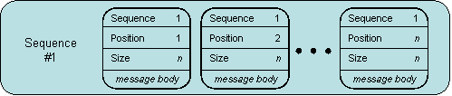

# Message Sequence

This page explains how you can implement a sample scenario of Message Sequence using WSO2 Micro Integrator.

## Introduction to Message Sequence

When transmitting a large set of data, you might want to break it into smaller chunks in order to maintain system performance. The Message Sequence EIP facilitates this by sending data as a sequence of smaller messages and marking each message with sequence identification fields. 

:::info

For more information, see the [Message Sequence](http://www.eaipatterns.com/MessageSequence.html).

:::

## How WSO2 Micro Integrator implements the EIP

When a large request is sent, the Micro Integrator, by default breaks it into smaller chunks. To maintain the consistency of the message, each chunk is then mapped with a sequence identifier number to preserve its sequential order.
