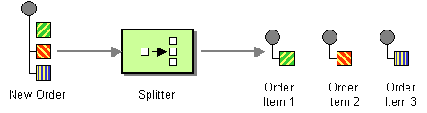
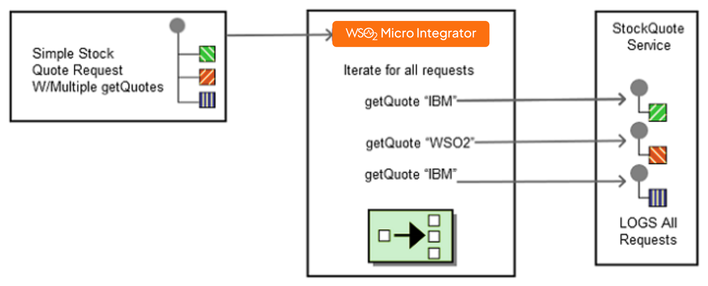

# Splitter

This page explains how you can implement a sample scenario of Splitter using WSO2 Micro Integrator.

## Introduction to Splitter

The Splitter EIP processes messages containing multiple elements that might have to be processed in different ways. The Splitter breaks out the composite message into a series of individual messages, each containing data related to one item. 

:::info

For more information, see the [Splitter](http://www.eaipatterns.com/Sequencer.html) documentation.

:::



## Sample scenario

This example demonstrates WSO2 MI implementing the Splitter EIP by processing a list of repeating elements, each of which will be processed individually. The client sends multiple requests in a single message. Using the Iterate mediator, each request will be processed individually and transmitted to a sample Axis2 server.

The diagram below depicts how to simulate the sample scenario using the WSO2 MI.



Before digging into implementation details, let's take a look at the relationship between the sample scenario and the Splitter EIP by comparing their core components.

| Splitter EIP            | Splitter Sample Scenario                 |
|-------------------------|------------------------------------------|
| New Order Request       | Stock Quote Request                      |
| Splitter                | Iterate Mediator                         |
| Order Item Request      | Endpoint (stock quote service instances) |

## Synapse configuration of the artifacts

<Tabs>
<TabItem value="tab-0" label="Proxy Service">

```xml
<?xml version="1.0" encoding="UTF-8"?>
<proxy name="SplitMessageProxy" startOnLoad="true" transports="http https"
   xmlns="http://ws.apache.org/ns/synapse">
   <target>
      <inSequence>
         <log category="INFO" level="full" />
            <property name="FORCE_SC_ACCEPTED" value="true" scope="axis2"/>
            <iterate attachPath="//m0:getQuote" expression="//m0:getQuote/m0:request" xmlns:m0="http://services.samples"
               preservePayload="true">
               <target>
                  <sequence>
                  <call>
                     <endpoint key="SimpleStockQuoteService" />
                  </call>
               </sequence>
            </target>
         </iterate>
         <drop/>
      </inSequence>
      <faultSequence/> 
   </target>
</proxy>
```

</TabItem>
<TabItem value="tab-1" label="SimpleStockQuoteService">

```xml
<?xml version="1.0" encoding="UTF-8"?>
<endpoint name="SimpleStockQuoteService" xmlns="http://ws.apache.org/ns/synapse">
   <address uri="http://localhost:9000/services/SimpleStockQuoteService"/>
</endpoint>
```

</TabItem>
</Tabs>

The Iterate mediator in the synapse configuration takes each child element of the element specified in its XPath expression and applies the sequence flow inside the iterator mediator. In this example, it takes each getQuote request specified in the incoming request and forwards this request to the target endpoint. 

## Set up the sample scenario

Follow the below instructions to simulate this sample scenario.

1. Install WSO2 Micro Integrator.

    :::info

    Follow the [Install the Micro Integrator Runtime](https://mi.docs.wso2.com/en/latest/install-and-setup/install/installing-mi/) documentation for more information.

    :::

2. Launch Visual Studio Code with the Micro Integrator for VS Code extension (MI for VS Code) installed.

    :::info

    Follow the [Install Micro Integrator for VS Code](https://mi.docs.wso2.com/en/latest/develop/mi-for-vscode/install-wso2-mi-for-vscode/) documentation for a complete installation guide.

    :::
    

3. Set up the back-end service:

    1. Download the [back-end service](https://github.com/wso2-docs/WSO2_EI/blob/master/Back-End-Service/axis2Server.zip).
    2. Extract the downloaded zip file.
    3. Open a terminal, and navigate to the `axis2Server/bin/` directory inside the extracted folder.
    4. Execute the following command to start the axis2server with the SimpleStockQuote back-end service:

    <Tabs>
    <TabItem value="tab-0" label="On MacOS/Linux">

    ```bash
    sh axis2server.sh
    ```

    </TabItem>
    <TabItem value="tab-1" label="On Windows">

    ```bash
    axis2server.bat
    ```

    </TabItem>
    </Tabs>

4. Download the artifacts of the sample.

    <a href="/integration/micro-integrator/assets/attachments/learn/enterprise-integration-patterns/Splitter.zip">
    </a>

5. Import the artifacts to WSO2 MI.

    Click **File** -> **Open Folder** -> Select the extracted ZIP file to import the downloaded ZIP file.

6. Start the project in the WSO2 MI server.

    For instructions, go to [Build and Run](../../../develop/deploy-artifacts.mdx#build-and-run) Documentation.

## Execute the sample

Send a request like the following to the client.

```bash
POST /services/SplitMessageProxy HTTP/1.1
Host: localhost:8290
SOAPAction: urn:getQuote
Content-Type: text/xml

<soapenv:Envelope xmlns:soapenv="http://schemas.xmlsoap.org/soap/envelope/" xmlns:ser="http://services.samples" xmlns:xsd="http://services.samples/xsd">
   <soapenv:Header/>
   <soapenv:Body>
      <ser:getQuote>
         <ser:request>
            <xsd:symbol>IBM</xsd:symbol>
         </ser:request>
          <ser:request>
            <xsd:symbol>WSO2</xsd:symbol>
         </ser:request>
         <ser:request>
            <xsd:symbol>IBM</xsd:symbol>
         </ser:request>
      </ser:getQuote>
   </soapenv:Body>
</soapenv:Envelope>
```

## Analyze the output

The Micro Integrator returns status code 202 to the client. The request payload will be logged in the Output tab of the VS Code.
