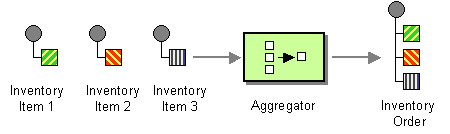
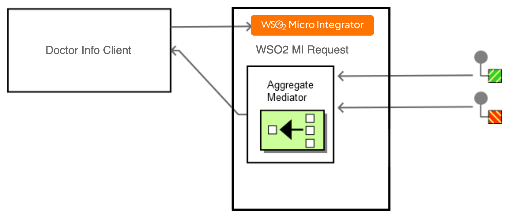

# Aggregator

This page explains how you can implement a sample scenario of Aggregator using WSO2 Integrator: MI. 

## Introduction to Aggregator

The Aggregator EIP combines the results of individual, related messages so that they can be processed as a whole. It works as a stateful filter, collecting and storing individual messages until a complete set of related messages has been received. It then publishes a single message distilled from the individual messages. 

:::info

For more information, see the [Aggregator](http://www.eaipatterns.com/Aggregator.html) documentation.

:::



## Sample scenario

This sample scenario demonstrates how WSO2 MI can be used to send multiple requests and merge the responses. Assume the sender wants to get responses from multiple servers, and it sends a message to the WSO2 MI. The WSO2 MI will duplicate the request to two different instances of a sample Axis2 server using the Clone Mediator. The Aggregate mediator will merge the responses received from each of the server instances and send the response back to the client.

The diagram below depicts how to simulate the sample scenario using the WSO2 MI.



Before digging into implementation details, let's take a look at the relationship between the sample scenario and the Aggregator EIP by comparing their core components.

| Aggregator EIP            | Aggregator Sample Scenario            |
|---------------------------|---------------------------------------|
| Doctors                   | HealthCare Endpoint Response          |
| Aggregator                | Aggregate Mediator                    |
| Doctors                   | WSO2 MI Response                      |

## Synapse configuration of the artifacts

<Tabs>
<TabItem value="tab-0" label="API">

```xml
<?xml version="1.0" encoding="UTF-8"?>
<api name="hospital" context="/" xmlns="http://ws.apache.org/ns/synapse">
  <resource methods="GET" uri-template="/getPhysicians">
     <inSequence>
        <clone>
           <target>
              <sequence>
                 <call>
                    <endpoint key="GrandOakEndpoint" />
                 </call>
              </sequence>
           </target>
           <target>
              <sequence>
                 <payloadFactory media-type="json" template-type="default">
                    <format>{
                    "doctorType": "Physician" } </format>
                    <args>
                 </args>
                 </payloadFactory>
                 <call>
                    <endpoint key="PineValleyEndpoint" />
                 </call>
              </sequence>
           </target>
        </clone>
        <aggregate>
           <completeCondition>
              <messageCount max="-1" min="-1" />
           </completeCondition>
           <onComplete aggregateElementType="root" expression="json-eval($.doctors.doctor)">
              <respond />
           </onComplete>
        </aggregate>
     </inSequence>
     <faultSequence>
        </faultSequence>
  </resource>
</api>
```

</TabItem>
<TabItem value="tab-1" label="GrandOakEndpoint">

```xml
<?xml version="1.0" encoding="UTF-8"?>
<endpoint name="GrandOakEndpoint" xmlns="http://ws.apache.org/ns/synapse">
   <http method="get" uri-template="http://localhost:9090/grandOak/doctors/Physician"/>
</endpoint>
```

</TabItem>
<TabItem value="tab-2" label="PineValleyEndpoint">

```xml
<?xml version="1.0" encoding="UTF-8"?>
<endpoint name="PineValleyEndpoint" xmlns="http://ws.apache.org/ns/synapse">
   <http method="post" uri-template="http://localhost:9091/pineValley/doctors"/>
</endpoint>
```

</TabItem>
</Tabs>

Let's investigate the elements of the synapse configuration in detail. 

- The Clone mediator is similar to the Splitter EIP. It clones the incoming request and passes the requests in parallel to several endpoints.   
- The aggregate mediator aggregates response messages for requests made by the Iterate or Clone mediators. The completion condition specifies a minimum or maximum number of messages to be collected. When all messages have been aggregated, the sequence inside onComplete will be run.

## Set up the sample scenario

1. Install WSO2 Integrator: MI.

    :::info

    Follow the [Install the WSO2 Integrator: MI Runtime](https://mi.docs.wso2.com/en/latest/install-and-setup/install/installing-mi/) documentation for more information.

    :::

2. Launch Visual Studio Code with the WSO2 Integrator: MI for VS Code extension (MI for VS Code) installed.

    :::info

    Follow the [Install WSO2 Integrator: MI for VS Code](https://mi.docs.wso2.com/en/latest/develop/mi-for-vscode/install-wso2-mi-for-vscode/) documentation for a complete installation guide.

    :::
    

3. Set up the back-end service:

    1. Download the [`DoctorInfo-JDK11.jar` file](../../../../../assets/attachments/quick-start-guide/doctorinfo-jdk11.jar). This contains two healthcare services.
 
    2. Open a terminal, navigate to the location of the downloaded `DoctorInfo-JDK11.jar` file, and execute the following command to start the services:

      ```bash
      java -jar DoctorInfo-JDK11.jar
      ```

5. Download the artifacts of the sample.

    <a href="/integration/micro-integrator/assets/attachments/learn/enterprise-integration-patterns/Aggregator.zip">
    </a>

6. Import the artifacts to WSO2 MI.

    Click **File** -> **Open Folder** -> Select the extracted ZIP file to import the downloaded ZIP file.

7. Start the project in the WSO2 MI server.

    For instructions, go to [Build and Run](../../../develop/deploy-artifacts.mdx#build-and-run) Documentation.

## Execute the sample

Send the following request to the WSO2 Integrator: MI.

   ```
   GET /getPhysicians HTTP/1.1
   Host: localhost:8290
   accept: */*
   ```
   
## Analyze the output

The user will be able to see the merged response of the available doctors from the two hospitals.

   ```json
   [
      [
         {
               "name": "Shane Martin",
               "time": "07:30 AM",
               "hospital": "Grand Oak"
         },
         {
               "name": "Geln Ivan",
               "time": "08:30 AM",
               "hospital": "Grand Oak"
         }
      ],
      [
         {
               "name": "Geln Ivan",
               "time": "05:30 PM",
               "hospital": "pineValley"
         },
         {
               "name": "Daniel Lewis",
               "time": "05:30 PM",
               "hospital": "pineValley"
         }
      ]
   ]
   ```
