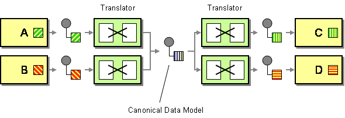

# Canonical Data Model

This page explains how you can implement a sample scenario of the Canonical Data Model EIP using WSO2 Integrator: MI.

## Introduction to Canonical Data Model

The Canonical Data Model EIP minimizes dependencies when integrating applications that use different data formats. It is independent of any specific application and requires each application to produce and consume messages in this common format. 

:::info

For more information, see the [Canonical Data Model](http://www.eaipatterns.com/CanonicalDataModel.html) documentation.

:::

### How WSO2 MI implements the EIP

The Canonical Data Model EIP minimizes dependencies between applications that use different data formats in messaging systems. This model ensures loose coupling between applications.

WSO2 MI supports several different data formats, including Plain Old XML (POX), JSON, and SOAP. Translating to a common data model (SOAP in WSO2 MI) and back to the original format is done using the underlying implementations of message builders and message formatters. If the receiving messages are not in the format the backend service requires, users can use the [XSLT mediator](../../../reference/mediators/xslt-mediator.mdx) or create a new message in SOAP format using the [Payload mediator](../../../reference/mediators/payloadfactory-mediator.mdx).

Also see [Normalizer](normalizer.mdx) for sample scenarios and explanations.
