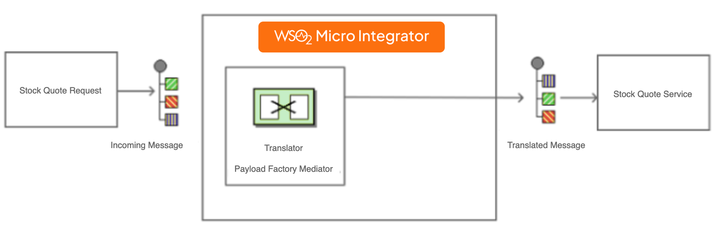
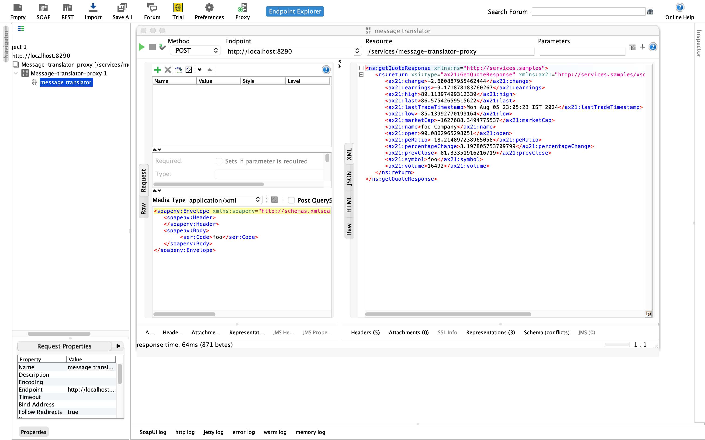

# Message Translator

This page explains how you can implement a sample scenario of Message Translator EIP using WSO2 Integrator: MI.

## Introduction to Message Translator

Typically, different applications use different data types. Therefore, for two applications to communicate successfully, you should translate the messages that pass from one application to a data type compatible with the receiving application. A translator changes the context of a message from one interface to another, allowing messages to adhere to the message context rules of the backend service.

The Message Translator EIP is responsible for message translating to ensure compatibility between applications supporting different data types.

:::info

For more information, see the [Message Translator](https://www.enterpriseintegrationpatterns.com/patterns/messaging/MessageTranslator.html) documentation. 

:::

## Sample scenario

The example scenario depicts an inventory of stocks. It illustrates how the sender sends a request in one format, which is then transformed into another format compatible with the receiver. The format of the request is as follows:

```xml
<soapenv:Envelope xmlns:soapenv="http://schemas.xmlsoap.org/soap/envelope/" xmlns:ser="http://services.samples" xmlns:xsd="http://services.samples/xsd">
   <soapenv:Header>   
   </soapenv:Header>
   <soapenv:Body>
        <ser:Code>foo</ser:Code>
   </soapenv:Body>
</soapenv:Envelope>
```

The message format compatible with the receiver is as follows:

```xml
<soapenv:Envelope xmlns:soapenv="http://schemas.xmlsoap.org/soap/envelope/" xmlns:ser="http://services.samples" xmlns:xsd="http://services.samples/xsd">
   <soapenv:Header/>
   <soapenv:Body>
      <ser:getQuote>
         <ser:request>
            <ser:symbol>foo</ser:symbol>
         </ser:request>
      </ser:getQuote>
   </soapenv:Body>
</soapenv:Envelope>
```

All requests in the first format should be translated to the second by the service. 

:::note

The translation is done through the Payload mediator.

:::



## Synapse configurations of the artifacts

:::note

When you unzip the ZIP file you downloaded below in step 7 when simulating the sample scenario, you can find the below configurations in the `<UNZIPPED_FILE>/src/main/wso2mi/artifacts` directory. For more information about these artifacts, go to [Develop Integration Solutions](../../../develop/intro-integration-development.mdx) Documentation.

:::

<Tabs>
<TabItem value="tab-0" label="Proxy Service">

```xml
<?xml version="1.0" encoding="UTF-8"?>
<proxy name="message-translator-proxy" startOnLoad="true" transports="http https" xmlns="http://ws.apache.org/ns/synapse">
    <target>
        <inSequence>
            <payloadFactory media-type="xml" template-type="default">
                <format>
                    <m:getQuote xmlns:m="http://services.samples">
                        <m:request>
                            <m:symbol>$1</m:symbol>
                        </m:request>
                    </m:getQuote>
                </format>
                <args>
                    <arg expression="//m0:Code" evaluator="xml" xmlns:m0="http://services.samples"/>
                </args>
            </payloadFactory>
            <call>
                <endpoint key="SimpleStockEp"/>
            </call>
            <respond/>
        </inSequence>
        <faultSequence/>
    </target>
</proxy>
```

</TabItem>
<TabItem value="tab-1" label="Endpoint">

```xml
<?xml version="1.0" encoding="UTF-8"?>
<endpoint name="SimpleStockEp" xmlns="http://ws.apache.org/ns/synapse">
    <address uri="http://localhost:9000/services/SimpleStockQuoteService">
        <suspendOnFailure>
            <initialDuration>-1</initialDuration>
            <progressionFactor>1</progressionFactor>
        </suspendOnFailure>
        <markForSuspension>
            <retriesBeforeSuspension>0</retriesBeforeSuspension>
        </markForSuspension>
    </address>
</endpoint>
```

</TabItem>
</Tabs>

## Set up the sample scenario

Follow the below instructions to simulate this sample scenario.

1. Install WSO2 Integrator: MI.

    :::info

    Follow the [Install the WSO2 Integrator: MI Runtime](https://mi.docs.wso2.com/en/latest/install-and-setup/install/installing-mi/) documentation for more information.

    :::

2. Launch Visual Studio Code with the WSO2 Integrator: MI for VS Code extension (MI for VS Code) installed.

    :::info

    Follow the [Install WSO2 Integrator: MI for VS Code](https://mi.docs.wso2.com/en/latest/develop/mi-for-vscode/install-wso2-mi-for-vscode/) documentation for a complete installation guide.

    :::
    

3. Download the [backend service](https://github.com/wso2-docs/WSO2_EI/blob/master/Back-End-Service/axis2Server.zip).

4. Extract the downloaded zip file.

5. Open a terminal, and navigate to the `axis2Server/bin/` directory inside the extracted folder.

6. Execute the following command to start the axis2server with the SimpleStockQuote backend service:

    <Tabs>
    <TabItem value="tab-0" label="On MacOS/Linux">

      ```bash
      sh axis2server.sh
      ```

    </TabItem>
    <TabItem value="tab-1" label="On Windows">

      ```bash
      axis2server.bat
      ``` 

    </TabItem>
    </Tabs>

7. Download the artifacts of the sample.

    <a href="/integration/micro-integrator/assets/attachments/learn/enterprise-integration-patterns/MessageTranslatorEip.zip">
        
    </a>

8. Import the artifacts to WSO2 MI.

    Click **File** -> **Open Folder** -> Select the extracted ZIP file to import the downloaded ZIP file.

9. Start the project in the WSO2 MI server.

    For instructions, go to [Build and Run](../../../develop/deploy-artifacts.mdx#build-and-run) Documentation.

10. Start SoapUI.

    For instructions on downloading and starting, go to [SoapUI Getting Started](https://www.soapui.org/getting-started/) Documentation.

## Execute the sample

Send the following request to the service using SoapUI (or any other SOAP client).

```
POST http://localhost:8290/services/message-translator-proxy 
Content-type: text/xml

<soapenv:Envelope xmlns:soapenv="http://schemas.xmlsoap.org/soap/envelope/" xmlns:ser="http://services.samples" xmlns:xsd="http://services.samples/xsd">
   <soapenv:Header>   
   </soapenv:Header>
   <soapenv:Body>
        <ser:Code>foo</ser:Code>
   </soapenv:Body>
</soapenv:Envelope>
```

## Analyze the output

After sending the request to the service through the client, notice that the request is successfully generated in the Stock Quote server.  The following output will be printed on the Axis2 server's Console, confirming that the request is successfully received by the backend service.

```bash
Mon Aug 05 23:05:23 IST 2024 samples.services.SimpleStockQuoteService :: Generating quote for : foo
```

You can view the response in the SoapUI as follows. 


